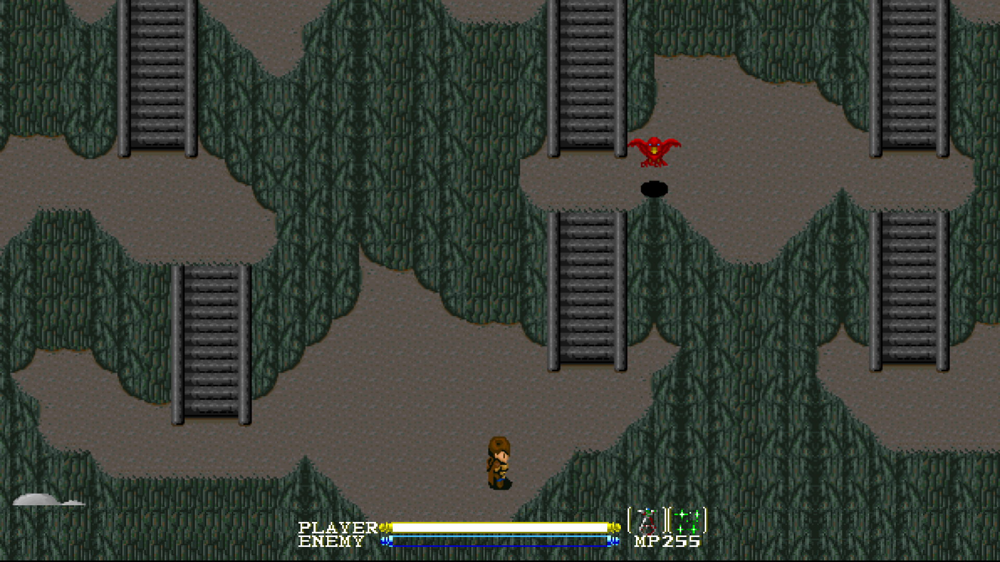

# Lagoon Recomp

[Release notes & checksums](https://github.com/rages4calm/LagoonSNESRecomp/releases/tag/v0.5.1) · [Screenshots](docs/screenshots/README.md) · [Controls](docs/PLAYING.md) · [Build & mod](docs/BUILDING.md)

**Lagoon for Windows, Linux and macOS, with 100% native execution of the game's
main 65816 CPU.** Built with [SNESRecomp](https://github.com/RetroPortingToolKit/snesrecomp),
with widescreen, enhanced original pixels, quality-of-life improvements, an
exploration map, achievements and an optional bundled X68000 soundtrack.

Normal play uses compiled game code with **no CPU interpreter fallback**.
The interpreter is retained as an explicit debugging/reference option. SNES
video, DMA, timers and SPC700/DSP audio hardware still use the runtime; native
CPU execution does not mean every hardware component has been replaced.

**Bring your own clean Lagoon USA ROM.** Downloads include the playable game
and self-contained Companion launcher. No ROM, game-code source extracted from
the ROM, saves or private test captures are included.

Square pixels, D3D11 MMPX Enhanced pixels and1.5x world zoom out at1920×1080.
[More screenshots, maps and menus](docs/screenshots/README.md).

## Features

- **Widescreen:** 16:9, 16:10, 21:9, 32:9 and window-driven aspects, with added
  scenery and supported NPCs, enemies, boss parts, projectiles and magic effects.
- **Enhanced original graphics:** optional GPU EPX or refined MMPX reconstruction with sharp
  fractional scaling keeps pixel interiors crisp and the HUD readable. No
  replacement artwork or whole-image blur is required.
- **D3D11 on Windows:** GPU Enhanced pixels, borderless fullscreen and tested
  OBS Game Capture/modern Window Capture through focus changes. OpenGL remains
  available and is used by the Linux/macOS packages.
- **World zoom out:**1x,1.25x and1.5x reveal additional scenery horizontally
  and vertically across the playable areas. All74 authored travel areas passed
  a bounded1.5x entry/render check; this is not a new full playthrough. The HUD remains readable over the
  scenery. Original authored scenes keep their original composition.
- **Game Over framing:** the original overlay keeps the expanded world and zoom
  instead of snapping back to a larger 4:3 image.
- **Active wider world:** newly revealed ordinary enemies wander with the
  original random-walk routine, without extending aggression or attack ranges.
  Their authored AI resumes in the original viewport. Neutral NPC animation extends
  beyond the old viewport; quest scripts and conversations retain their triggers.
- **Combat and balance options:** longer sword reach and matching sword artwork,
  modest cleave, extra hit protection, a gentler opening and stronger magic.
- **Less repetition:** independent EXP and gold rates up to 8x, faster walking,
  quicker menus, longer jumps and a centered camera.
- **Better escorts:** first aid for Giles without consuming a Healing Pot,
  followers that navigate walls and stairs at Nasir's pace, and Thor's bridge
  crossing. The cloud-to-castle landing is more forgiving too.
- **Scenery map (0.4.0):** **M / L2** opens the current area's full terrain,
  with pan, zoom, fit-to-area and recenter controls. Numbered discovered exits,
  destination pages, treasure and early tablet-quest hints help with navigation.
  Visited scenery stays available while browsing and after a restart. Older
  exploration-only areas gain scenery on a fresh visit; unavailable scenery
  retains the labeled explored-layout view.
- **Readable extra menus (0.4.0):** Lagoon-style black panels, ivory frames and
  clear lettering across the map, achievements and **R2 / Ctrl+comma** Options.
  Five tabs cover **Sound, Journal, Items, Display and Travel**.
- **Adventure help (0.4.0):** a journal follows your actual story progress;
  25 item explanations include carried status and Atland/Voloh shop prices.
- **Optional sword range cue (0.4.0):** see the active reach and cleave while
  attacking. It defaults off and does not change combat.
- **Dungeon return (0.4.0):** after defeating its boss, return inside a supported
  dungeon's main entrance through **Options → Travel**. Stand safely still,
  away from nearby threats and outside an escort; confirm before returning.
- **26 local achievements:** bosses, exploration, the ending and a hidden guest.
  Compact notifications and a chime; **Ctrl+J** opens the browser. Progress works offline.
- **Two soundtracks:** choose **Original SNES** or the bundled **X68000** album
  in Companion, with separate music-volume control and original sound effects.
- **Companion launcher:** display, audio, keyboard/controller bindings and QoL
  settings, plus achievement browsing. Windows and portable Linux/macOS interfaces.

## Play

1. Download the package for your OS and extract the entire folder somewhere writable.
2. Open **Setup Lagoon.cmd / lagoon.Companion.exe** on Windows, or
   **Start Lagoon.command / lagoon.Companion** on Linux/macOS.
3. On first launch, click **Choose ROM file…** and select your original USA .sfc or .smc file. Verification and setup run automatically; then press **Play**.

Choose the actual ROM file, not its folder or ZIP. You can keep it outside the game folder.
Use **Choose ROM.cmd / Choose ROM.command** to select a different ROM later.
For recording, use **Borderless fullscreen** and OBS **Game Capture → Capture specific window → LagoonSNESRecomp.exe**. [Recording help](docs/RECORDING.md).

No compiler or first-run game recompilation is needed. Windows needs no separate
.NET or Python installation; Linux/macOS bundle .NET and use Python 3.11+ for
first-run ROM setup. Keep `local/` for your saves, settings, map and achievements.
[Controls and upgrading](docs/PLAYING.md) · [Linux/macOS requirements](docs/PORTING.md) · [Soundtrack details](docs/SOUNDTRACK.md).

## What's new in 0.5.1

The zoom renderer now restores qualified actor graphics after loading later-game
save states, draws complete sprites across the old screen/HUD limits, and separates
HUD glyphs from world sprites. Phantom Hill's cloud travel band follows the
expanded view. Loading/fade fallbacks preserve world pixel scale instead of
briefly stretching back to the original view.

**Pixel proportions** offers **Square pixels** and **Original CRT proportions**,
independently of widescreen and1x/1.25x/1.5x zoom. New installations use square
pixels; existing saved preferences remain available. Source-bound moving checks
cover the owner's six available save states, menu return and nearby transitions;
the older74-area entry sweep is not a substitute for moving-route coverage.

## What's new in 0.5.0

Windows now has a D3D11 flip presenter with GPU Enhanced pixels and tested OBS
capture through focus changes. Companion adds1x,1.25x and1.5x world zoom-out
options on all platforms. Qualified world scenes show additional terrain and
actors in both directions, with a transparent HUD over the scenery. Visible
ordinary enemies stay active rather than waiting for the old viewport's
awareness range. Neutral NPC animation extends to the wider view too.

The strict native CPU default and explicit interpreter reference option remain.
Original authored scenes and unqualified visual states keep their original
composition. See [Display and recording](docs/RECORDING.md) for settings.

## What's new in 0.4.1

First launch now offers a ROM file picker and automatic verification/setup, with
clear messages for folders, archives and unsupported ROMs. Desktop fullscreen
is now labeled **Borderless fullscreen**. OBS capture instructions cover explicit
game-window selection. The qualified 0.4.0 game engine is retained unchanged.

## Scenery maps and menus introduced in 0.4.0

The map now draws complete zone terrain from the game's own scenery instead of
using only collision-cell diagrams. It keeps the original art, including the
layered backgrounds in Gold Cave, Philips Castle, Dwarf Cave, Phantom Hill and
the Cloud. Actors and the HUD stay out of the terrain image. Seeing the terrain
does not mark it explored, reveal an undiscovered chest or unlock a door.

Pan and zoom independently of readable labels, fit the whole area, or recenter
on Nasir. Discovered exits receive matching numbers on the map and destination
list, with pages for busier areas. Destinations remain unnamed until visited.
L/R browsing retains each area's last mapped scenery across room changes, state
loads and restarts. It stores only local terrain data, without actors or progress.

The new Options tabs bring story guidance, item help and optional sword-range
display into the game. Travel supports the main entrances of **Gold Cave,
Philips Castle, Dwarf Cave, Siegfried Castle, Ice Cave and Lagoon Castle** after
the corresponding boss is defeated. It uses the game's normal room-loading
sequence and checks safety again when you confirm. It does not bypass a boss,
escort or story gate.

These additions passed focused source, UI and affected-route checks.
They do not represent another complete playthrough or a new Linux/macOS campaign.

## What's new in 0.3.0

- Native CPU execution is the default in every platform package, without a
  Python test wrapper or environment setup. Unknown CPU paths stop before
  interpretation rather than silently falling back.
- Fixed one-frame black widescreen margins caused by briefly different
  background-layer scroll positions.
- Fixed the old doorway scene reappearing after fade-out while another room loads.
- Fixed an alternate legitimate ending path missing its achievement trigger.

The main CPU backend passed 95 exact native/reference test cases, with
568 million generated instructions and zero interpreter invocations. Room
loading checks cover all 74 nonempty original areas. State, timing, frames and
offline DSP output matched; the two rendering fixes also preserve game state.
The owner previously completed the Windows campaign and explored every map.
These are finite checks, not a promise of bug-free behavior in every mod or edited save.

Linux/macOS builds have target compilation, graphics, persistence and launcher
checks. Their complete target gameplay and real controller/audio playthroughs
remain separate from the Windows campaign. [Testing scope](docs/PORTING.md).
Unsupported widescreen effects may still use the original view; that is a
presentation decision, not CPU interpreter fallback.

## Build and mod

The native title code, renderer, UI, QoL hooks, shaders and mod manifests are
available to extend. [Build instructions](docs/BUILDING.md) explain how to
reproduce the game locally from your ROM and the pinned, patched framework.
Native CPU profile generation stays local; generated ROM-derived C is never
committed to the public repository. ROM code patches need matching native
profiles. Incompatible code changes stop instead of reverting to interpretation.

The scenery map, journal, item guide and extra-menu presentation are title-owned
code available to extend. [Development guide](docs/DEVELOPMENT.md).

## Credits and licensing

QoL ideas were inspired by **oipo's**
[Lagoon QoL hack](https://www.romhacking.net/hacks/9856/).
See [full credits](CREDITS.md) for the original developers and project dependencies.

Retain the included licenses: the SNESRecomp foundation and derivatives use
**PolyForm Noncommercial**; Companion Launcher and the Lagoon launcher adapter
use **MIT**, as do CompanionAchievements and cJSON under their own included
notices. Public source availability does not remove the noncommercial terms.
The readable extra-menu font is **Atkinson Hyperlegible Next**, under the
separate **SIL Open Font License 1.1**; its notices accompany playable packages.
ROMs, extracted Lagoon assets, saves and private validation captures are not
uploaded or distributed. Generated ROM-derived code is excluded from public
source and downloads; authorized platform builds use private build inputs.
The tiny credited Chrono Trigger cameo has its
own original copyright; it is not MIT-licensed artwork. The gallery contains
selected development screenshots.

## Community and contact

Discord: **chrono.trigger**

[**R.A.I.D. — Retro AI Development**](https://discord.gg/Ad9BwSzctP) · a Discord
for AI-assisted retro reverse-engineering, decomp & recomp. I post my work there;
join to discuss this project and the others.
