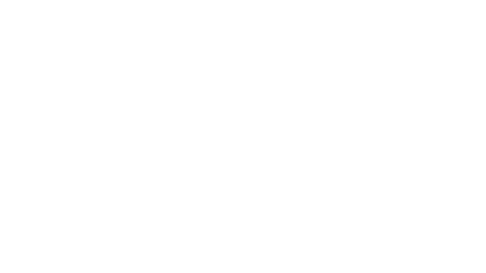

# Lagoon Recomp

A work-in-progress Windows port of Lagoon (USA), using SNESRecomp's generated
native routines alongside its 65816 interpreter safety net. Your own clean ROM
is required. The executable does not depend on Mesen; it is a development reference.

## Current progress - October 20, 2026

Batch27 adds two complete native routines: the alternate/fall player animation
and shared boss death progression. Their original timers, sprite tail, cleanup
service and reward handoff are preserved. Three matched assisted routes pass
**7,810 ordered observations and six complete state/clock checkpoints**. The
alternate-animation route uses explicit staged player state; it is not a natural
fall or complete campaign test.

The selected build contains **410 AOT /112 analyzed LLE /289 roots**. All408
prior native entries,392 prior mode facts,23 mode sets and four HLE guards remain.
Counts are not completion percentages. The original inline boss service and
unsupported modes still use the interpreter safety net; this is not a fully
native game or a complete credits qualification.

The custom renderer adds six exact field contexts: **18 /1D /1E /1F /20 /21**.
Six actual enemy kinds render beyond the native view, with original animation,
OAM geometry, palette and priority. Four contexts have independently verified
8-phase scenery animation. Six loader pairs and three genuine enemy routes
match **8,927 ordered pictures and twelve complete checkpoints**, with6,665
replacements and zero renderer mismatches. Intentional new margin pixels remain
differences in old/new comparisons. Unknown actors, scripted NPCs in21 and
loading/fading retain the appropriate reference fallback.

The exact tested executable is installed. Cold ordinary-boss, alternate-animation
and new-field checks match **48 component hashes and full ordered pictures**;
all110 protected owner inputs remain unchanged. The field comparator retains a
strict-false advisory report-path difference. No mismatch masks or rebuilt
installation are used. The original raster remains active.

A bounded hidden1920x1080 OpenGL/Enhanced sample in room18 averages60.10
presentation updates/s,p9517.73ms,max18.28ms across400 intervals,zero above25ms.
It uses dummy audio and ran alongside headless checks; it is not an isolated
hardware benchmark, physical scanout or all-room60FPS guarantee. The owner and
friends perform the uninterrupted campaign; assisted checks here use cheats,
original room loaders and combat/scripts. Jev provides visual triage only.

See [batch27](docs/NATIVE-BATCH27-2026-10-20.md),
[the custom renderer](docs/CUSTOM-RENDERER.md),
[1080p captures](docs/screenshots/README.md) and
[frame pacing evidence](docs/PERFORMANCE.md).
[Batch26](docs/NATIVE-BATCH26-2026-10-20.md) fixed the centered-camera native
bypass and added the four NPC contexts19..1C. Previously finished boss, recovery,
menu and scene work remains in [batch25](NATIVE-BATCH25-2026-10-20.md),
[batch24](NATIVE-BATCH24-2026-10-20.md) and
[batch23](NATIVE-BATCH23-2026-10-20.md).

The five audited menu checks open Items/Magic/Equipment in20/18/19 fields and
close in22 using twelve original charged DMA jobs. Giles accepts wound dressing
without a potion and follows through his original quest script. Optional improved
sword reach adds three lateral pixels on each side to its existing38px reach.

Guarded host computation of two original enemy-position leaves improves measured
Gold Cave gameplay cadence without skipping AI, collision or hardware work.
Batch19's1920×1080 real-audio tests measured about60.12 presentation FPS; the sampled
cave changes from69 three-field updates to525 two-field updates with no slower
updates. This is bounded evidence, not a locked60FPS or all-room guarantee.
Room02's44 incoming water-fade fields and room03's46 outgoing fade fields now
retain independently source-verified scenery and native center pixels.

Focused checks cover actual damage, seven boss death/defeat endpoints, original
rewards, consumable revival and quest interactions. Broader native death/boss
orchestration, unsupported scenes and hardware/controller coverage remain open.
Read the [playtest guide](docs/PLAYTEST.md), [batch19 stabilization evidence](NATIVE-BATCH19-2026-10-17.md),
[current status](docs/DEVELOPMENT-STATUS.md), [todo list](TODO.md),
[menu details](docs/FAST-MENUS.md), [widescreen scope](docs/WIDESCREEN.md),
[performance evidence](docs/PERFORMANCE.md) and [save states](docs/SAVE-STATES.md).
Earlier results remain in [batch18](NATIVE-BATCH18-2026-10-17.md); historical
exploration is not relabeled as a natural complete playthrough.

## Fullscreen screenshots

[View the 1,920×1080 fullscreen captures](docs/screenshots/README.md), including
wide town dialogue, Items/Magic, Atland and Gold Cave.



## Launcher

Use `Start Lagoon.cmd` after building. It opens the shared
[Companion Launcher](https://github.com/rages4calm/companion-launcher), using pinned
0.2.0 packages. The Lagoon adapter verifies your ROM and starts the native game
with its existing config and save locations. The old pre-boot UI is excluded from
the default build; it can be enabled explicitly for development.

Companion exposes executable/ROM/config paths, native display/audio/gamepad
settings, gameplay QoL toggles and experimental widescreen aspects. Apply/Revert
preserves unknown settings and controller bindings and detects stale edits.
Existing native settings remain in `build/config.ini`, input in `build/keybinds.ini`,
and saves in `build/saves`. The adapter does not migrate them.

For a 1,920×1080 monitor, use desktop fullscreen, widescreen 16:9 and optional
Enhanced original pixels. Keep linear filtering and frame blending off for a
sharp picture, with VSync on. Window scale controls only windowed size; leaving
it at 3 is fine in fullscreen. Wider 21:9/32:9 modes reveal more scenery but
make the picture shorter on a 16:9 monitor. The underlying 4:3 display-aspect
setting preserves original pixel proportions while widescreen adds scenery.

## Build from source

Install the Windows toolchain/dependencies documented by
[SNESRecomp](https://github.com/RetroPortingToolKit/snesrecomp): Python 3.10+,
Rust, CMake, Ninja, a supported C/C++ toolchain, SDL3 and zlib. Use a configured
build shell. Generate locally from your own original USA ROM:

```sh
git submodule update --init --recursive
python -P tools/apply_framework_patch.py
bash tools/regen.sh --rom "/path/to/Lagoon (USA).sfc"
cmake -S . -B build -G Ninja -DCMAKE_BUILD_TYPE=Release
cmake --build build -j
```

On Windows, use Git's Bash rather than an unconfigured WSL stub. `regen.sh` also
applies/checks the required framework patch. `framework_pins.txt` records the
upstream baseline; `patches/lagoon-framework.patch` carries the local compatibility
and precise-root timing changes. The public submodule pin is reachable upstream.

Build CompanionLauncher 0.2.0's local NuGet packages, then:

```powershell
powershell -File scripts/build_launcher.ps1 -CompanionRoot C:\path\to\CompanionLauncher
```

The game expects SHA256
`46c811f0cacffe8f20e1d63072d25d7c47e9bb3fd5124851fd05aca9884d21fb`,
CRC32 `d2554270`, a 1 MiB unheadered USA LoROM. Patched ROMs are deliberately
rejected by this clean-ROM build. Generated C is ROM-derived and remains local.

## QoL and widescreen

All nine requested QoL changes are implemented and default off. They use guarded
ROM data changes and shared CPU read/write hooks, so generated native routines and
the interpreter see the same gameplay values. Camera centering changes guarded
operands in explicitly interpreted routines, preserving the original scenery
streamer. The supplied BPS informed this
work; it is not bundled or automatically applied. See
[QoL implementation and limits](QOL-IMPLEMENTATION.md) for exact balance values
and the distinction between synthetic tests and gameplay evidence.

Optional widescreen draws additional world backgrounds in supported rooms at
the original pixel scale, with 16:9, 16:10, 21:9, 32:9 and window-driven aspects.
Witnessed ordinary NPC/enemy forms can also appear beyond the game's original
off-screen actor buffer, using resident graphics and read-only presentation
animation. Current scenery support covers audited Atland, Gold Cave and the
outdoor guard exterior (room 2), audited cave rooms 4–6, room 07 parallax and
Elf Field (room 08), clipped to real world bounds. Verified dialogue/Start retain scenery and Items/Magic widen their
frames. Other rooms, title/intro and unadapted panels use native-width fallback.
Special actors, other parallax layouts and campaign coverage remain unfinished. All four fixed aspects preserved guest state and native
center pixels at 18 opening/town checkpoints. See [widescreen details](docs/WIDESCREEN.md).

## Optional enhanced original pixels

Companion's Display page offers **Enhanced original pixels (EPX)**. It rounds
pixel diagonals using the original colors and keeps the bottom HUD sharp.
This follows the original-art treatment used in Secret of the Stars; the full
retexture experiment is shelved. EPX defaults off, requires OpenGL, and restores
your previous graphics settings when disabled. See [the implementation and
bounded GPU checks](docs/ENHANCED-PIXELS.md).

## Optional X68000 soundtrack

The optional soundtrack uses a privately imported VGZ pack, with loop points
preserved. Initial replacement covers opening, Atland and GoldCave; other cues
retain SNES music. SNES audio remains the default. No music is bundled in the
repository. See [setup and current limits](docs/X68000-SOUNDTRACK.md).

## Source and publishing

See [credits](CREDITS.md), including the original
[Lagoon QoL hack](https://www.romhacking.net/hacks/9856/) that inspired the
requested comfort changes.

This repository contains source, build configuration and development tools. It
excludes ROMs, generated ROM-derived C, private decompilation exports, extracted
assets, saves, states, screenshots and test captures. No playable release is being
published with this source snapshot. GitHub updates are deliberate batch snapshots,
not an automatic per-feature sync.

Retain the included licenses: the SNESRecomp foundation and its derivatives use
PolyForm Noncommercial; Companion Launcher and the Lagoon launcher adapter use MIT.
Public source availability does not remove the framework's noncommercial terms.
