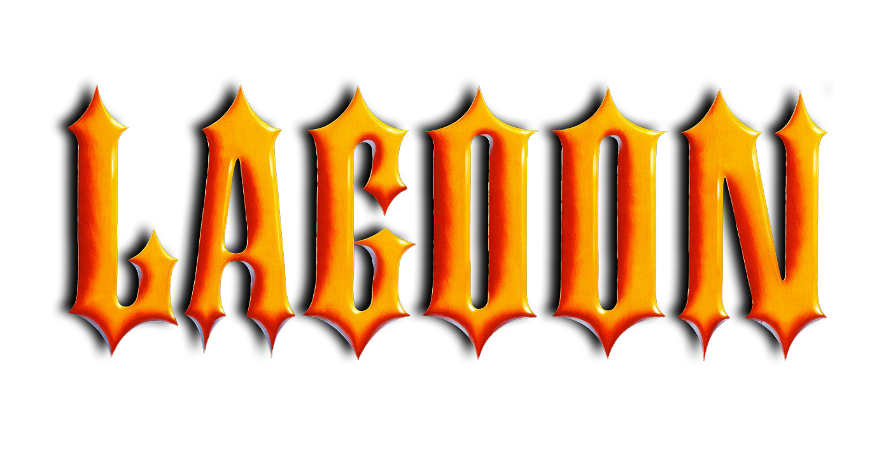
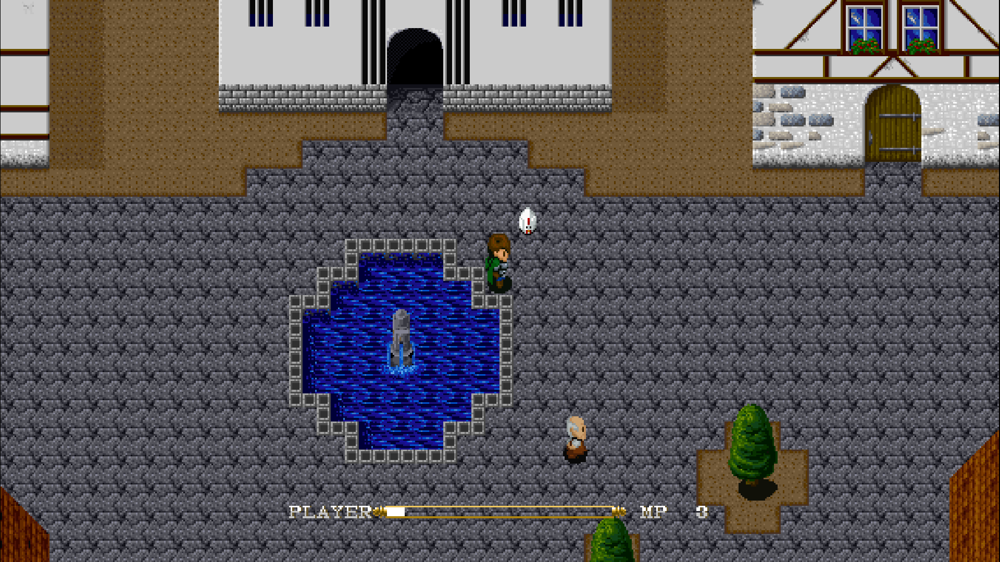

# Lagoon Recomp

**Windows 0.6.1: SNES Enhanced and X68000 Enhanced in one Companion launcher.**
Choose the version you want to play. Each has its own game files, settings, saves and achievements.

[Release notes and checksums](https://github.com/rages4calm/LagoonSNESRecomp/releases/tag/v0.6.1) | [Controls for both editions](docs/PLAYING.md) | [Screenshots](docs/screenshots/README.md) | [Build and mod](docs/BUILDING.md)

**Linux and macOS downloads remain SNES-only, version 0.5.3:**

## Start playing

Extract the **whole Windows ZIP** into a writable folder, then open **Setup Lagoon.cmd** or **lagoon.Companion.exe**. The launcher asks which edition to open. Use **Choose edition** in its sidebar to switch later.

### SNES Enhanced

1. Choose **SNES Enhanced**.
2. Click **Choose ROM file...** and select your clean, original **Lagoon USA .sfc or .smc** file. Select the file itself, not its folder or ZIP.
3. Let verification and setup finish, then press **Play**.

The SNES game is prebuilt: Windows needs no Python, compiler or separate .NET installation. You can keep your ROM outside the extracted folder. **Choose ROM.cmd** reopens the picker later. Linux/macOS users open **Start Lagoon.command**; [portable requirements](docs/PORTING.md) include Python 3.11+ for first setup.

### X68000 Enhanced - Windows

1. Choose **X68000 Enhanced** and select your supported four-disk Lagoon **ZIP or folder**.
2. Press **Set up game**. Setup obtains its verified portable tools and compatible firmware automatically. There is no manual Python, Visual Studio, compiler or firmware installation.
3. Leave setup open until it finishes, then press **Play** in Companion. First setup needs internet access and space for the downloaded tools and local build.

The supported game input is the four **DIM disk images**, either in a ZIP or extracted folder. Setup checks their content. It accepts the supported English 0.9b disks, or applies the English patch to the supported Japanese System disk. You can also put your ZIP under **Inputs/X68000/** and run **Setup X68000.cmd**. **X68000 setup** in Companion retries setup or selects different inputs later. Custom firmware is an optional advanced setting.

**X68000 setup builds the game locally once.** It downloads and verifies RetroRecomp 1.8.0, compatible IPL/font firmware, portable build tools and, when needed, nleseul's English patch. It never downloads Lagoon disks. The resulting X68000 executable embeds your game, so it stays on your PC. The public Windows release contains the setup tools and enhanced runtime source needed to create it.

The optional **X68000 soundtrack in the SNES game** and the **playable X68000 edition** are separate features. Selecting that soundtrack does not select the other game.

## Features

### SNES Enhanced

- **Native main CPU:** compiled 65816 game execution by default, with strict refusal of uncovered CPU paths. The interpreter is an explicit developer reference option; video, DMA, timers and SPC700/DSP audio use the hardware runtime.
- **Widescreen and live zoom:** 16:9, 16:10, 21:9, 32:9 or follow-window views; 1x, 1.25x and 1.5x world zoom. Expanded scenery, supported NPCs, enemies, boss parts, projectiles and effects; centered camera option.
- **Enhanced original pixels:** GPU EPX or refined MMPX with sharp fractional scaling, square-pixel or original CRT proportions, and a readable HUD. D3D11 on Windows; OpenGL on Linux/macOS. No replacement artwork or whole-screen blur.
- **Combat options:** 38-pixel sword reach, modest cleave and matching blade extension, extra protection after hits, stronger magic and a gentler opening.
- **Less repetition:** optional faster walking, longer jumps, and separate EXP/gold rates up to 8x. Menus open and close faster.
- **Better escorts:** potion-free first aid for Giles, obstacle-aware followers at Nasir's pace, and Thor's bridge crossing. The cloud-to-castle landing is more forgiving.
- **Scenery map:** full area terrain with pan, zoom, recenter, discovered exits and destinations, treasure markers and early tablet hints. Visited scenery stays available after restarting.
- **Extra in-game menus:** audio, display, journal, item explanations and safe return to cleared dungeon entrances. Quit to desktop without Alt+F4.
- **26 offline achievements:** bosses, exploration, quests, ending and a hidden guest, with compact notifications, a chime and in-game/launcher browsers.
- **Two music choices:** original SNES audio or the included converted X68000 album, with separate music volume and original SNES effects.
- **Companion settings:** keyboard, controller and hotkey bindings; display, audio and optional gameplay changes. Existing preferences are preserved.

Gameplay options are selectable in Companion. Faster menus, Giles first aid and follower navigation are built in. See the [exact QoL values](docs/PLAYING.md#snes-quality-of-life-options).

### X68000 Enhanced

This is the original Sharp X68000 game with its own story events and thrust-and-contact combat. Its gameplay improvements are **built in**, rather than split into profiles or toggles.

- **English translation**, Start/Enter opening skip, and automatic disk changes with a ready-to-save User Disk.
- **Expanded 16:9 view with square pixels**, centered camera and live 1x / 1.25x / 1.5x zoom. Expanded scenery and supported actors; the original HUD moves to the bottom in zoomed views.
- **38-pixel sword reach and 4 pixels of lateral cleave**, respecting walls and keeping the original sword artwork, damage rolls and enemy death behavior. Hold the sword ready while moving into enemies.
- **Faster movement and recovery:** three pixels per walking step, eight extra jump-peak updates and sixteen extra protection updates after ordinary hits.
- **Gentler opening:** 18 HP and 8 base defense; level 2 maximum HP is 21.
- **2x enemy/boss EXP and gold**, plus 50% stronger damaging magic after defense and resistance.
- **Quicker dialogue, Items/Equipment and ordinary door waits.** Save/Load keeps the original game menu, with disk handling automatic.
- **Potion-free Giles rescue.** He returns to town through the original event; this version has no Giles escort or SNES-style Thor tablet hunt.
- **49-map scenery Atlas:** pan, zoom, visited-room browsing, doorway markers, recorded crossings, item help, regional journal, controls and eight offline awards.
- **In-game audio/zoom settings and Quit**, with controller navigation. Dialogue quick states preserve the surrounding scenery. Global palette effects cover the expanded view without leaving black margins.

The X68000 edition retains RetroRecomp's X68000 hardware/runtime and compatibility support. The SNES edition's native-CPU claim does not apply to the X68000 build. [X68000 controls and saves](docs/PLAYING.md#x68000-enhanced).

X68000 Atland at **1.25x**. Actual expanded-compositor output, nearest-neighbor
scaled and aspect-fitted to 1920x1080; original artwork. [More X68000 and SNES screenshots](docs/screenshots/README.md).

## Quick controls

These are the default **PC keyboard and Xbox-style physical controller labels**. Other controller layouts may print different letters. All shortcuts are explained in the [playing guide](docs/PLAYING.md).
**L2/R2** means **LT/RT** on an Xbox-style pad; **R3** means pressing the right stick.

| Action | SNES Enhanced | X68000 Enhanced |
| --- | --- | --- |
| Move | Arrows / D-pad | Arrows / D-pad |
| Sword | Z / A | Hold S / A, then move into the target |
| Jump | X / B | D / B |
| Talk | S / Y | D / B |
| Map | M / L2 | Ctrl+M / R3 |
| In-game settings | Ctrl+comma / R2 | Ctrl+comma / R2 |
| Cycle world zoom | Ctrl+Z / R3 | Ctrl+Z / L2 |
| Quick state | Shift+F1 saves; F1 loads slot 1 | F8 saves; F9 loads |

**The save-state keys differ between editions.** Normal in-game saves are separate. For X68000's original dialogue and Save/Load menu, use **B / D** to confirm; Sword cancels a yes/no choice to No.

## Saves, updating and recording

**Windows 0.6.1 updates:** Companion's **Check for updates** checks the official stable Windows release. A package update keeps your locally built X68000 game and both editions' saves/settings. **Update X68000 game** is separate: runtime changes require a local rebuild, reusing cached inputs and tools when available. Missing inputs may require selecting your game ZIP again. Source checkouts can check/open the release; automatic replacement is for extracted release folders.

**Coming from 0.6.0?** That launcher has no updater yet. Close both games and
Companion, extract the **entire 0.6.1 ZIP over your existing release folder**,
and replace the packaged files. Keep **local/** and **local-x68000/**; the ZIP
contains neither folder. Open Companion, choose **Update X68000 game → Update
game** once for the opening fixes, then play. Future package updates use
**Check for updates → Download and update**. If you modified the packaged source
or application files yourself, use a fresh folder and the [save-transfer guide](docs/PLAYING.md#manual-updates).

X68000's title and prologue play at normal speed until you explicitly skip with **Start / Enter**. Their original square-pixel artwork fits proportionally in the window. Windowed and Borderless fit use the available height; Borderless pixel perfect keeps integer scaling. Gameplay widescreen and world zoom are separate.

Keep **local/** for SNES saves, settings, maps and achievements. Keep **local-x68000/** for X68000's generated game, settings, User Disk and progress. The editions do not share saves. Follow the [upgrade instructions](docs/PLAYING.md#upgrading-and-your-progress); do not overwrite or rename incompatible quick states.

For older X68000 saves, open **Copy X68000 saves** in Companion. If your previous
installation is not listed, click **Choose previous installation...**, select
it, and copy an ordinary source slot into an empty destination slot. The tool
preserves the updated game's files.

For SNES recording on Windows, select **Borderless fullscreen** and use OBS **Game Capture -> Capture specific window -> LagoonSNESRecomp.exe**. [Recording help](docs/RECORDING.md). The X68000 game is a separate window named **Lagoon - Atlas**; select that game's window when recording it. The SNES D3D11/OBS checks do not qualify every X68000 capture setup.

[More screenshots](docs/screenshots/README.md) | [DarkShadowRage's SNES full playthrough](https://www.youtube.com/watch?v=YdY6WtsjzGg)

## Build, mod and testing scope

[Build instructions](docs/BUILDING.md) cover both editions. The renderer, menus, QoL hooks and source tools are available to extend. ROMs, X68000 disks/firmware, extracted assets, generated C source, saves and private validation data stay out of public source and downloads. Build your own X68000 export locally; do not redistribute its embedded game/firmware payload.

The SNES Windows campaign was completed start to finish by the owner. X68000 qualification used assisted travel and OP stats to execute all eight boss defeats, the original ending, death/reload and major quest handovers. That is useful coverage, rather than an uninterrupted normal-difficulty playthrough. Target builds and focused checks do not guarantee every graphics driver, controller or edited save will behave identically. Report the edition, location, settings and reproduction steps in the [issue tracker](https://github.com/rages4calm/LagoonSNESRecomp/issues).

## Credits and licensing

QoL ideas were inspired by **oipo's** [Lagoon QoL hack](https://www.romhacking.net/hacks/9856/). The X68000 English translation is by **nleseul**; its patch is downloaded from the [translation project](https://github.com/nleseul/lagoon_x68k_trans). X68000 conversion/runtime uses [ArthurReboulSalze's RetroRecomp](https://github.com/ArthurReboulSalze/RetroRecomp). Compatible firmware comes from the pinned [WebX68k bundled-ROM project](https://github.com/uraraworks/WebX68k#bundled-rom--disk-images), with its IPL permission notice and public-domain Shinonome font notices retained. See [full credits](CREDITS.md) for original developers and dependencies.

Retain all included licenses. SNESRecomp and its derivatives use **PolyForm Noncommercial**; Companion Launcher, its Lagoon adapter, CompanionAchievements and cJSON use **MIT** under their notices. The menu font **Atkinson Hyperlegible Next** uses **SIL Open Font License 1.1**. Third-party X68000 tooling retains its own licenses. Public source availability does not remove those terms or the original games' copyrights. The credited Chrono Trigger cameo is not MIT-licensed artwork.

## Community and contact

Discord: **chrono.trigger**

[**R.A.I.D. — Retro AI Development**](https://discord.gg/Ad9BwSzctP) · a Discord for AI-assisted retro reverse-engineering, decomp & recomp. I post my work there; join to discuss this project and the others.
