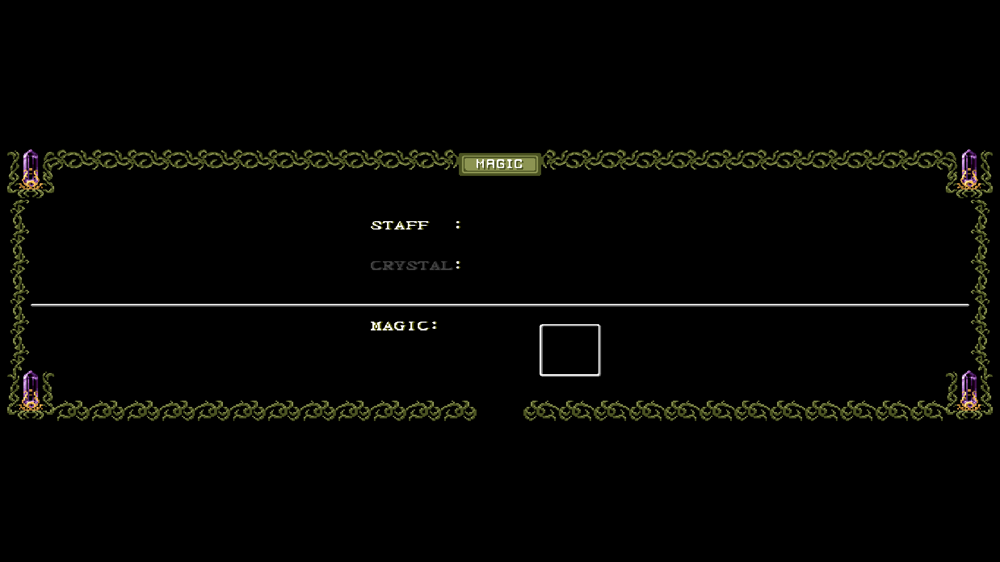

# Wide Items, Magic and Equipment presentation

When experimental widescreen is enabled, verified Items, Magic and Equipment screens reuse the original ornate frame across the available width. The title, text, cursor and item/magic body retain their original source pixels and stay centered. This is a host compositor change: it does not change guest RAM, PPU memory, gameplay, fonts or artwork.




Both PNGs are lossless conversions of actual 1920x1080 fullscreen OpenGL readbacks with Enhanced pixels enabled. The 32:9 viewport is letterboxed on this 16:9 monitor. These are running-game captures, separate from the standalone compositor's small source-pixel test previews. The early-game inventory is mostly empty; populated late-game panels remain to be checked.

## Original-art layout

The compositor moves the original side and corner pieces to the new edges, repeats the existing 24-pixel chain period, and keeps the 80-pixel title segment centered. Expansion uses symmetric 48-pixel steps. Its virtual width is `256 + 48 * floor((actualWidth - 240) / 48)`; slight excess clips only the original outer black margin, never text or ornament. Narrower residual gaps remain black. Magic's existing divider extends in its original two colors. Nothing is stretched or newly drawn.

The centered content body at native x=40..215, y=32..199 is copied exactly. Top/bottom center art is preserved. Output pitch padding and source/destination aliasing are supported.

## Conservative identification

`src/lagoon_menu_presentation.c` requires the matching scene flag, loaded resource pointer, visible PPU mode, screen maps, zero scroll, and two serialized VRAM fingerprints: shared border/font graphics plus the immutable Items or Magic map perimeter/title. A black screen or BG3 presence alone is insufficient. It also checks chain periodicity before reflow. Unknown templates and modes decline without touching the destination. Save, cutscenes and other unaudited panels keep the existing fallback.

## Equipment frame

The Equipment panel has its own immutable perimeter/title fingerprint. It keeps
its complete 144-pixel upper center (native x=56..199), which contains the longer
original title, while Items and Magic keep their existing 80-pixel title region.
The left and right frame pieces still move in symmetric 48-pixel steps. Original
24-pixel chain samples fill the added space; sixteen-pixel joins on each side
are checked against the adjacent original period before drawing. Equipment's
original divider at rows 154/155 extends using its two existing row colors.

No equipment names, statistics, cursor or Nasir animation are synthesized. The
body remains copied from the current native field. A changed title/perimeter,
font resource, scene flag, scroll or unsupported mode declines to the existing
fallback. The standalone production-compositor test covers a real Equipment
frame at all eight supported test widths, unchanged body/title pixels, original
row colors, invalid chain/divider refusal, padded rows and in-place composition.
These layout checks are distinct from running-game integration qualification.

The focused running-game Equipment check uses a private wide-only build from
the selected 346-variant program. Across 1,097 matched presentation fields, 445 opening/stable/closing
Equipment fields gain wide original-art frames; all 652 other fields are
unchanged. Every changed pixel matches the original row and chain phase, with
13,157,760 body pixels and2,050,560 title pixels preserved. All six complete
guest checkpoints, including SRAM and clocks, are exact. This early inventory
fixture does not certify populated late-game equipment or unknown panels.
Its private receipt is `work-native-batch14-20261017-181844/widescreen/EQUIPMENT-FOCUSED-QUALIFICATION.json`.
The final integrated build with core menu acceleration and native recovery
continuations passed three additional same-binary wide/narrow pairs: Atland,
the cave, and room01. Across 3,305 presentation fields, 1,491 Equipment fields
compose 227,777,088 pixels from the original source rows and chain phases.
All 44,085,888 body pixels and 6,870,528 title pixels remain exact. All eight
guest components, including SRAM and clocks, match at all 14 checkpoints.
Only the host Widescreen setting differs between each pair. The final 32:9
composite and original title were also inspected visually. These checks retain
the early inventory limitation above and do not measure fullscreen performance.

Executable SHA-256: `9b63dc19d3a9d4f92e269a14b28d8375758e3543d7bfd00205151c94b1a4787a`.
Manifest SHA-256: `8e77084f01c937896a4aeaef1b91aea464acd7c724325dcb5065f93f5deb2027`.
Private receipt: `work-native-batch14-20261017-181844/widescreen/FINAL-EQUIPMENT-THREE-AREA-PROOF.json`.

The same final build also retained the qualified room01 status, fade and
state-load behavior across 2,112 matched wide/narrow fields and 13 complete
guest checkpoints. Margin bounds and original source colors pass; the 50
fields following state restoration match the earlier accepted presentation
exactly. The restored Atland scene remains wide without retaining room01's
cached margins. Private receipt: `work-native-batch14-20261017-181844/widescreen/FINAL-MODAL-SOURCE-PROOF.json`.

## Integration verification

### Room08 backdrop and Save prompt

The next ordinary-map backdrop uses its own audited resource tuple and exact
1536 by 1024 extent. Its world, cave-collapse dialogue, Save prompt and return
to the world can retain original-art margins. The dialog box, text and entire
native center stay unchanged. All existing character, map, OAM, PPU and state
generation checks still apply; this is not a general admission of later rooms.

The first Start panel in this fixture still declines for 35 fields when its
resource ownership cannot be proved. That fallback remains intentional and is
tested explicitly. Room07 also remains unsupported: its quarter-speed BG2 uses
a vertical tilemap, requiring a separate parallax resolver. Merely adding its
room number would not establish correct scenery ownership.

An isolated baseline check also confirmed that Atland's existing Save prompt
already retained wide scenery before this change. No Save-specific drawing fix
is claimed there. The private room08 source/actor and complete guest-state
checks are recorded in
`work-native-batch15-20261017-191138/widescreen/ROOM08-FOCUSED-QUALIFICATION.json`;
the final combined native/menu build passed the same two routes with matched
wide/narrow settings: 2,368 presentation fields and all eight guest components
at 15 checkpoints agree. Across 1,643 valid wide fields, the backdrop contains
136,904,490 nonblack margin pixels. Twelve snapshots match original background
colors plus original OAM/VRAM/CGRAM actor pixels at the exact same coordinates.
The actual Save and Start maps also match the inspected original UI templates;
Start's 35-field refusal remains explicit. This is source-pixel and state proof,
not a fullscreen performance measurement.

Final executable SHA-256: `26b96b8f4c2c02e5be908e424df1a44a810baf4573e84afa971b6e964ff366ba`.
Manifest SHA-256: `3d6f473e2c69ba3d26f76c9e8c6b0c15e031845dbec64356d6d678effb86398b`.
Private integrated receipt: `work-native-batch15-20261017-191138/widescreen/final-room08-FINAL-PROOF.json`.

### Historical Items/Magic integration (October15)

Combined executable SHA-256: `14be32d86a553a27f47971bf5479f9900d225c832f6ee5dc016b870d1423a507`.

Same-route wide/narrow checks matched the complete guest framebuffer, WRAM, CPU/PPU register dump, VRAM, OAM, CGRAM and clock information at all four snapshots for both Items and Magic. All 2,007 Items and 2,013 Magic presentation frame/alpha entries matched. Host-composed CRCs differ as expected because the frame is wider; they are not a guest-state parity claim.

Actual pre-GPU 342x224 Items and 682x224 Magic composites retained every original body and title pixel exactly and introduced zero new colors. The GPU screenshots above include optional EPX filtering after that composition. Visual inspection found clean repeated seams and readable original text.

The C11 unit test also passed synthetic widths 256, 258, 280, 308, 342, 448, 684 and 800; native/minimum reconstruction, alpha preservation, padded rows, immutable input, alias safety, disabled refusal and mutated identity/resource/mode refusal were checked. Real dumps from both integrated GPU runs passed the same production compositor checks.

```powershell
gcc -std=c11 -O2 -Wall -Wextra -Werror -I snesrecomp/runner/src tests/lagoon_menu_presentation_test.c -o <private-test.exe>
& <private-test.exe> <private-dump-prefix> <existing-private-output-directory>
```

The private evidence receipt is `work-native-20261015-145037/menu-integrated-acceptance.json` beside this checkout. No owner configuration, save or mod state was changed for qualification.
