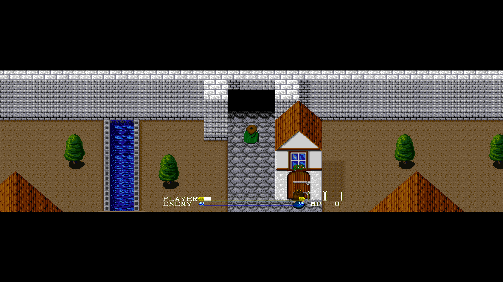

# Performance and frame pacing

## Batch29 layered room12 bounded sample

The actual hidden1920x1080 OpenGL/Enhanced32:9 capture uses executable
`4fbe90fc6ee8e8a0ca0c3e6dff891086c8668327ba6285a03d302382c551f1ab`,
manifest `e375af907ee1127369de439db42c0717394e4feb29925dd22daccf4d2ebbe74c`.
Room12 is a narrow512-pixel authored mountain pass with a quarter-scroll
background and camera coordinates beyond the ordinary1024-pixel scroll range.
The renderer preserves the real map edges rather than inventing more terrain.

Across400 consecutive intervals in fields1200..1600, mean16.63904ms gives
60.09962 presentation updates/s, p9517.5905ms, p9917.9940ms and maximum18.5479ms.
Zero intervals exceed20ms. The actor replay coordinator was suspended for the
sample; a previously running short child was allowed to finish during startup.
This uses dummy audio and measures presentation calls, not physical scanout,
real-device audio, all story states or a guaranteed game-wide60FPS.

The route records1408 custom replacements,149 independent draws and zero
mismatches. Its complete682x224 pre-shader picture and two eight-component
state/clock checkpoints match a headless SDL run. The actual1920x1080 GPU
readback is published losslessly; see [capture details](screenshots/README.md).
Jev provides read-only triage and does not accept rendering correctness.

The final renderer-only addition binds animation to rooms32..34. It does not
change this room12 contract; final evidence records that source/object scope
separately from the original captured executable.

## Batch28 room24 bounded sample

Exact executable `feef9b2199a3f93ca9dabda87eaf924ce9fd0fa71fd91bcedd22abbc2cb38600`,
manifest `8071eb6c28ab93805384253e7941df5e5c20626bbc5421b9acb77a8e64f72030`.
A hidden 1920x1080 OpenGL window uses Enhanced EPX and a 32:9 field, letterboxed
on the 16:9 output. The assisted original loader and NPC route use dummy audio
and no physical input. It runs alongside headless native qualification.

The 400 consecutive intervals in source fields1200..1600 average16.6390ms
(60.0997 presentation updates/sec), p95 17.7887ms, p99 20.1215ms and maximum
22.5207ms. Five exceed20ms and zero exceed25ms. Mean active processing is2.8475ms.
The complete route records1,434 replacements,642 independent scene draws and
zero mismatches. This is a bounded presentation-call sample, not physical
scanout, isolated hardware benchmarking, real-device audio or all-room60FPS.

The actual GPU readback at1068 is published as a lossless1920x1080 PNG; decoded
RGBA pixels match the original BMP exactly. The pre-shader expanded image and
two original checkpoints (16 component hashes) match the headless route. Jev
only triages the image and executes no game actions.

See [capture and scope](screenshots/README.md). Older measurements below retain
their original executable bindings.

## Batch22 room07 actual-door check

Selected executable `dde68792632ccea8bb80436f630188cf40161ea551bd352349c23c88ed4d9138`.
A hidden1920x1080 OpenGL/Enhanced(EPX),16:9 run with the real audio device traverses
original03→04→05→06→07 doors, using explicit position assistance. No campaign
warp, physical input, screenshots or per-field file writes are used. Buffered
timing/probe output and the sole final checkpoint are written outside the sample.

All551 logic rows in fields2000..2550 remain in room07 without loading. Across550
presentation intervals, mean16.64215ms, p9517.6789ms, maximum18.7177ms and zero
intervals above25ms give60.0884 presentation updates/sec. The final checkpoint
at2583 confirms room07 and an actual custom-renderer replacement; the final33
fields, including its dump I/O, are excluded. The whole route has1,688 replacements
and zero mismatches, including earlier caves. This is one bounded presentation-
call measurement, not fullscreen scanout, locked60FPS or campaign-wide pacing.

## Earlier measurements

The measurements and executable hashes below are historical, bound to their
named batches. Batch 17 qualifies native execution and rendering correctness;
it does not replace these measurements or establish full-game locked 60 FPS.
See the [current development status](DEVELOPMENT-STATUS.md) for the selected build.

The final batch 8 build measured 60.10 fps in the settled, bounded Atland check with diagnostic presentation logging disabled. Its p95/p99 intervals were 17.44/17.83 ms, with one interval above 20 ms. Audio safety and guest timing remain unchanged. These measurements cover this machine and route; occasional spikes remain, and this is not a hard real-time or full-game guarantee.

This batch 7 image is an actual 1920x1080 OpenGL fullscreen readback, with 32:9 scenery letterboxed on a 16:9 monitor and optional EPX enabled. The PNG was converted losslessly from the readback without resizing. Original artwork is retained.

## Earlier batch 7 measurements

Measured on Windows 11 Home build 26200, Intel Core Ultra 7 265F (20 cores/20 logical processors), NVIDIA GeForce RTX 5070, driver 32.0.16.1664, and a 75 Hz class 1920x1080 display (integer WMI reports 74 Hz). Private settings and a fresh version-3 state were used. The isolated harness uses a dummy audio device, so real audio-device pacing remains outside this measurement.

| Check | Measured interval | Rate | Frame-time p50 / p95 / p99 | Intervals >20 / >25 ms |
|---|---|---:|---|---:|
| Controlled prior build, long 21:9 SDL route | 4,673 intervals after field 1750 | 59.86 fps | 16.70 / 18.26 / 19.61 ms | 37 / 14 |
| Batch 7 visible 32:9 OpenGL + EPX | 2,892 intervals after field 150 | 59.79 fps | 16.67 / 18.56 / 23.78 ms | 109 / 13 |
| Batch 7 clean hidden 1920x1080 GPU, 32:9 OpenGL + EPX | 1,640 intervals, fields 150..1790 | 60.12 fps | 16.63 / 17.71 / 21.36 ms | 29 / 1 |

An interval above a threshold is not itself proof of a dropped display frame. Percentiles use the sorted lower sample. The native guest rate is approximately 60.1 fields per second; small differences from this rate arise from bounded measurement windows and timing phase.

The **visible** run included startup/state loading and completed 3,042 fields in 51.015 seconds: **59.63 fps overall**, using 11.359 CPU seconds. Two WMI hardware inventory queries ran during it and may have contributed to scheduling spikes; the single screenshot/readback and endpoint dumps also add overhead. The screenshot is useful visual evidence, but this run is not a clean proof of uninterrupted 60 fps.

A separate **hidden** GPU run avoided inventory queries, GPU readbacks and repeated dumps. Its final dump interval was excluded from the table. The moving portion measured 60.11 fps; the settled profile used about 1.45 ms guest simulation, 0.80 ms raster/capture, 1.12 ms composition and 0.22 ms upload/presentation per field, with about 13.01 ms in deadline waiting. It used 6.172 CPU seconds across the full 29.959-second, 1,792-field process interval. Guest timing stayed within 1.000000..1.000176 field periods per simulation. Hidden-window timing does not certify visible fullscreen scheduling.

The earlier fullscreen dialogue capture averaged 46.22 fps. Repeating its same route/configuration without overlapping heavy work produced 59.88 fps overall, with a 59.86 fps profiled interval. The earlier slow result was not reproduced under those controlled conditions; its precise cause was not established.

## What changed

The SDL3 deadline wait now uses its precise delay facility for the short tail instead of repeatedly yielding with `SDL_Delay(0)`. The SDL2 fallback remains available. This targets wait jitter while preserving guest clocks, simulation frequency and real multi-field loader work. It is not a new threaded renderer, GPU guest CPU, DirectX 12 backend or frame-skipping workaround. The measurements involve multiple runtime/route changes and do not isolate an exact speedup from this wait change alone.

A single same-route hidden A/B trial used precise waiting for the whole remaining deadline. It measured 60.08 fps, but p95/p99 were 19.11/23.58 ms versus 17.71/21.36 ms with the short-tail policy. CPU time rose from 6.172 to 7.047 seconds over the approximately 30-second run. The whole-deadline trial was rejected and reverted. It is kept as private experiment evidence, while the measured short-tail build remains selected. One A/B pair cannot eliminate OS scheduling variance.

The flashing defect was a separate state-restoration problem: the PPU's two static raster journals were missing from saved state. Cold loading could replay a cold-boot register baseline every other field even while guest memory, CPU and PPU writes were correct. The version-3 continuation saves both completed and pending journals, including writes after the V=225 boundary. Changing graphics backends or shaders would not restore that missing state.

After the fix, cold loading matched 64 consecutive warm-run snapshots and 62 uninterrupted snapshots across native framebuffer, WRAM, registers, VRAM, OAM, CGRAM and clock information. Hidden SDL and OpenGL/EPX readbacks each checked 141 consecutive frames: only the startup frame was black; all 140 frames following the load were nonblack. The single approved final fullscreen run detected no repeated black-frame pattern, and its actual GPU capture shows the expected world. States from the earlier incomplete format are intentionally rejected.

## Evidence scope

The private batch directory is `work-native-20261015-154136`, alongside this checkout. Receipts bind executable, route, state and configuration hashes:

- `performance-baseline-report.json`: prior-build controlled timing.
- `raster-flashing-verification.json`: cold/warm/uninterrupted state and hidden GPU verification.
- `performance-final-verification.json`: actual fullscreen capture and timing limitations.
- `performance-clean-verification.json`: separate clean hidden-GPU timing.
- `performance-precise-verification.json`: same-route whole-deadline wait trial.

The batch 7 measured executable SHA-256 is `03fcc1f6eb0fef35c9a3427bf36d1c6aa36adf8faed9103f465d0f670f35b2c2`. No owner save, settings or mod-state files were changed. Other rooms, later encounters, real audio devices, different drivers and other hardware need their own measurements.

## Batch 8: separating work from audio waits

An opt-in diagnostic records raw `QueryThreadCycleTime` counts beside wall time. In the first quiet probe, all 89 guest segments longer than 5 ms used at most 1.5 times their ordinary same-processor cycle count. This supports waiting or descheduling rather than proportionally more executed guest work. All sampled endpoints were on the faster processor class; no E-core-affinity fix was justified. Processor IDs are sampled at presentation end and cannot rule out migration inside a stage. Raw cycles are not converted into milliseconds, as required by [Microsoft's API guidance](https://learn.microsoft.com/en-us/windows/win32/api/realtimeapiset/nf-realtimeapiset-querythreadcycletime).

Narrow audio counters then identified the main wait in the logged check: the existing bounded producer high-water guard deliberately waits for the audio consumer. In this **187-entry diagnostic build**, the same executable, route, fresh state, settings and features produced:

| Hidden 32:9 GL/EPX check | p95 / p99 interval | Intervals >20 ms | Audio high-water entries | Total high-water wait | Mean composition |
|---|---:|---:|---:|---:|---:|
| Presentation CRC/luma logging on | 21.88 / 23.88 ms | 117 | 186 | 977.54 ms | 1.084 ms |
| Presentation logging off | 17.44 / 17.75 ms | 3 | 5, all early | 16.90 ms | 0.084 ms |

In the logged run, 114 of 115 guest segments over 5 ms coincided with more than 1 ms of audio backpressure; mutex acquisition never exceeded 1 ms. After field 200, the no-log run had **zero** high-water entries, ran at 60.10 fps and had one interval above 20 ms. Both runs ended with identical native framebuffer, WRAM, registers, VRAM, OAM, CGRAM and clock information. This is evidence of an interaction between diagnostic logging and audio pacing in this route, not evidence that the original gameplay needed more CPU threads. It does not establish the exact contribution of file flushing versus checksum CPU cost or their effect on audio-callback phase.

No audio-buffer safety, playback policy, guest timing, affinity or process priority was changed. Ordinary play already omits the presentation log. `tools/qualify_native.py --no-present-log` now exposes this performance control and records `present_log_enabled=false` in its receipt; default qualification retains the CRC/luma log. The flag refuses the CPU screenshot-range option because that range independently enables its own per-field CRC log. The original A/B used a private environment override, whose exact removal is recorded separately; later confirmation uses the public flag.

The A/B executable SHA-256 is `dc2f8f5fba1d9f7d742cd1bac15a8e72d2d85fbe6621b77238bd87ad4305a8af`; its manifest is `b5b9cdeaf30067a9bb13c18e0ecb758519c610ccabf4598a4da6a7d5abecd1da`. Evidence is in the private `work-native-20261015-161718/cycle-profile-analysis.json` and `audio-pair-analysis.json`. These diagnostic-build measurements are separate from the final batch 8 build.

Hidden, inaudible Windows 11 applications can receive different timer/QoS treatment from focused or audible ones, so hidden results are not a replacement for fullscreen checks. No such policy was changed here. See [Microsoft's timer-resolution documentation](https://learn.microsoft.com/en-us/windows/win32/api/timeapi/nf-timeapi-timebeginperiod). CSV timestamps end at renderer presentation calls; they do not measure physical scanout or prove which frames were displayed on a 75 Hz monitor. Threshold counts are long CPU presentation intervals, not identified dropped display frames.

## Final batch 8 confirmation

The final executable contains 188 AOT variants, with the interpreter safety net retained. A single quiet, hidden, normal-paced 1920x1080 OpenGL/EPX run used the public `--no-present-log` flag, the same 32:9 route and fresh version-3 state, and all nine original QoL features. There were no screenshots, hardware inventory queries or initiated background tests during the measurement. The final dump interval was excluded.

| Final check | Rate | p50 / p95 / p99 interval | Intervals >20 / >25 ms | Audio high-water entries |
|---|---:|---:|---:|---:|
| Fields 150..1790, 1,640 intervals | 60.11 fps | 16.66 / 17.45 / 17.86 ms | 3 / 0 | 5 during settling |
| Settled fields 200..1790, 1,590 intervals | 60.10 fps | 16.66 / 17.44 / 17.83 ms | 1 / 0 | 0 |

The longest profiled interval was 22.11 ms. Guest periods remained within 1.000000..1.000176 per simulation. Mean composition took 0.082 ms without the diagnostic CRC/luma log. The full 1,792-field process interval, including startup and state loading, took 29.959 seconds and 4.828 CPU seconds. Its final native framebuffer, WRAM, registers, VRAM, OAM, CGRAM and clocks matched the 187-variant no-log control exactly. No audio-buffer safeguard or scheduling policy was removed to obtain this result.

This confirms the settled timing improvement for the tested production-like logging configuration, rather than promising identical timing in every later room, with every audio device or at physical monitor scanout. The full-resolution screenshot above remains accurately labeled as the earlier batch 7 capture; no additional visible window was opened for this final check.

Final executable SHA-256: `25b3b33272d74beccc1213423d4379a9ebf1bbe550ed91e32e84f4b275001bda`. Manifest SHA-256: `ca8099f0601967b4b13614f90fc26a192a2637be15a2fe0bc1d20bed11eac3b7`. The private `work-native-20261015-161718/final188-performance-verification.json` binds the route, settings, seeded-state hashes and explicit disabled-log receipt.

## Initial batch 9 live scene backend measurement

The bounded [custom scene renderer](CUSTOM-RENDERER.md) now independently draws
supported Atland fields and replaces only exact full-field candidates. Its
reference PPU renderer still runs for comparison. This stage establishes live
correctness and coverage, and adds work; it is not yet a rendering speedup.

Before the source-decoding cache optimization, one quiet hidden 1920x1080
OpenGL/Enhanced Pixels run used the same 32:9 route,
settings and fresh v3 seed as the prior batch 8 check. Default **auto** was used
without a mode override. Presentation CRC/luma logging and GPU readbacks were
disabled, the scene report wrote once at exit, and no initiated background tests
or hardware queries overlapped the run. The final dump interval was excluded.

| Hidden check | Rate | p50 / p95 / p99 interval | Intervals >20 / >25 ms |
| --- | ---: | --- | ---: |
| Historical batch 8, fields 150..1790 | 60.11 fps | 16.66 / 17.45 / 17.86 ms | 3 / 0 |
| Batch 9 default auto, fields 150..1790 | 60.06 fps | 16.66 / 18.01 / 23.17 ms | 52 / 1 |
| Batch 9 settled fields 200..1790 | 60.06 fps | 16.66 / 18.05 / 23.21 ms | 52 / 1 |

The mean stayed near the guest rate, but this run had more long intervals than
the historical reference. Its longest interval was 25.35 ms. The audio producer
entered its bounded high-water wait 78 times, totaling 399.56 ms; the three
largest intervals coincided with 9.07, 14.62 and 7.31 ms of that wait. Ordinary
raw guest thread-cycle counts during those intervals support waiting rather
than proportional extra guest execution. No buffer safeguard, audio policy,
priority or affinity was changed to hide the waits.

Mean composition was 1.473 ms versus 0.082 ms in the earlier no-log reference;
mean raster/capture was 0.864 ms, guest 1.650 ms, and upload/presentation 0.230 ms.
The full 1,792-field interval, including startup and loading, took 29.977 seconds
and 7.594 CPU seconds. All seven final guest components/clocks matched the prior
batch 8 endpoint exactly. Guest periods remained within 1.000000..1.000176.

The exit report confirms actual custom output: **1,772 independently rendered
and replaced fields**, **270,704,896 pixel observations**, zero mismatches and
20 startup fallbacks at internal 682x224. OpenGL/Enhanced Pixels postprocessing
was enabled with staged shader hashes verified against source. No visible
window was opened.

This is a historical same-route comparison, not a controlled same-executable
renderer-off/auto performance A/B, so it does not isolate every cause of the
extra jitter. Hidden/dummy-audio presentation-call timestamps do not certify
focused fullscreen, physical monitor scanout or real audio-device timing. This
run supports a bounded mean near 60 fps, not locked frame times or a campaign
performance guarantee.

Executable SHA256: `fd6044196a395c182b213e9605806c6137a38003e07b8e20c540f5d1fbc0b0cc`.
Manifest SHA256: `b8720505d6b6b1f57c04b9dbac7abeba56c3e02f3f99485801dc416be78f934e`.
Private evidence: `work-native-20261015-164402/scene190-performance-verification.json`
and `performance-scene190-invocation.json`, with the full timing CSV and exit
report under `performance-scene190/`.

## Optimized batch 9 confirmation

The selected backend caches decoded planar source rows, palette conversions and
eight-pixel map spans. It also reuses an independent candidate across adjacent
fields only when all captured rendering inputs are byte-identical. The full
reference comparison, guest clocks, audio safeguards and presentation policy are
unchanged. Every displayed replacement is still checked; cached drawing does not
skip simulation or output fields.

One sequential **same-executable** off/default-auto pair repeated the exact
hidden 1920x1080 OpenGL/Enhanced Pixels 32:9 route, state, settings and nine
original QoL options. All agents stopped heavy work during both runs. Both used
`--no-present-log`, no GPU readbacks or hardware inventory queries, and exit-only
renderer reports. Profile fields 150..1790 exclude the final dump interval.

| Same-executable mode | Rate | p50 / p95 / p99 interval | Intervals >20 / >25 ms | Mean composition |
| --- | ---: | --- | ---: | ---: |
| Renderer off | 59.54 fps | 16.65 / 20.39 / 24.27 ms | 90 / 11 | 0.108 ms |
| Default auto | 60.10 fps | 16.65 / 17.83 / 18.23 ms | 3 / 2 | 0.356 ms |

The off control had a **135.61 ms** interval, including 112.44 ms in the
upload/presentation stage. Its cause was not established. This single ordered
pair is not evidence that enabling the backend increases frame rate; callback
phase and OS/driver scheduling variance remain possible confounders. The measured
composition overhead over off was about 0.247 ms. Compared with the explicitly
historical pre-cache run, observed mean composition fell from 1.473 to 0.356 ms,
about 76%, while retaining exact output.

The default-auto maximum interval was **30.09 ms**, and all three intervals above
20 ms are retained in the table. Settled fields 200..1790 measured 60.10 fps,
17.83/18.22 ms p95/p99, and **zero audio high-water waits**. The full profile had
three early entries totaling 3.81 ms, versus 105 entries/573.13 ms in the off
control. The largest auto intervals did not coincide with audio high-water
waits. This supports the bounded result without promising locked 60 fps or
eliminating scheduling spikes.

Default auto actually replaced **1,772 fields** with zero mismatches, from
**844 independent redraws and 128,936,192 independently drawn pixel observations**;
the other 928 replacements reused byte-identical source candidates. Twenty
startup fields fell back. Full-resolution GPU postprocessing remained enabled
after the internal 682x224 compositor. No additional visible window was opened.
All seven final guest components/clocks were byte-identical between off and auto.
Guest periods remained 1.000000..1.000176 per simulation.

The auto process used 5.547 CPU seconds over its full 29.967-second, 1,792-field
interval; off used 5.375 CPU seconds over 30.261 seconds. Auto's mean guest,
raster/capture and upload/presentation stages were 1.444, 0.892 and 0.222 ms.
Hidden/dummy-audio timing remains separate from focused fullscreen, real audio
devices, physical scanout and campaign performance.

Selected executable SHA256:
`81bf8a4bf685fca8994836e3701499677ad9afded0139673b5732e269d97b814`.
Manifest SHA256:
`b8720505d6b6b1f57c04b9dbac7abeba56c3e02f3f99485801dc416be78f934e`.
Private `work-native-20261015-164402/optimized190-performance-verification.json`
binds both receipts, CSVs, shader hashes, default-auto report and exact endpoint
comparison; `performance-opt190-invocation.json` records the two invocations.

## Batch 19: cave enemy cadence and final fullscreen check

The original main loop clears0418 at018088 and waits for at least two NMI
fields at01814E. In Gold Cave03, enemy coordinate work sometimes overran that
budget: presentation remained near60Hz while game logic took three fields.
The guarded native clamp/project computation now applies only to normal live
type2 enemies in rooms03..06. It retains original AI/collision, the real return
frame/RTS and hardware timeline; it does not overclock or subtract elapsed time.
Unknown contexts execute the original generated bodies. There are no new AOT modes.

Final executable432b5a5808eebcf8395d14c2399b43e1402a1149965c16a55a1bf875c8bb0629
was tested at1920×1080/16:9, OpenGL, VSync, Enhanced original pixels and the real
audio device (private volume0). All three runs share one frozen assisted dungeon
state and the same scripted movement. No compilation/heavy parallel test ran
during the measurements. Fields150..1200 exclude startup/loading/final dumps;
the visible readback interval247..253 is excluded from its timing statistics.

| Mode | Presentation-call rate | p95 interval | Maximum interval | Three-field logic ticks |
| --- | ---: | ---: | ---: | ---: |
| Hidden, computation disabled |60.124Hz|17.981ms|21.438ms|69|
| Hidden, default native computation |60.120Hz|17.496ms|22.015ms|0|
| Desktop fullscreen, default computation |60.116Hz|17.459ms|21.438ms|0|

The enabled runs each contain525 two-field logic updates; the disabled run has
421 two-field and69 three-field updates in the same measurement window. This
fixes measured guest slowdown without making the original30Hz logic into60Hz
physics. Neither enabled run has a measured interval above25ms in this window.
The real audio safeguard remains active (11 high-water waits per enabled
window); it was not removed to improve the numbers.

This is bounded CPU presentation-call timing, not physical monitor scanout,
locked frame times or a complete-campaign guarantee. The readonly optional
LAGOON_FRAME_PROBE diagnostic buffers movement/logic samples until exit.
The qualifier supports --real-audio for isolated visible/offscreen checks;
ordinary deterministic tests retain dummy audio.

## Batch 23: updated framework pacing check

After integrating the 61 upstream framework files through
`37aba0b33c909b31344286f881cfb3086cbaa630` and five new native bodies, the
installed `27758caa6deb6bc275cb3ef0001d3d3b30cf46b80661d0e4d59ffddc4d6e05d7`
executable was checked with the existing portable batch22 performance route.
The manifest is
`9b718937025e37deae97ed8bd29c72d1f7923184f1fffb7e68e576016f96e7af`.

The hidden 1920x1080 OpenGL/EPX16:9 run uses the real audio device with private
volume zero. Original doors carry the route through rooms03/04/05/06/07 with
explicit position assistance, no campaign warp plan, new seed or physical input.
Stable room07 fields2000..2550 contain550 presentation intervals:60.08677
updates/s, mean16.64260ms, p9517.347ms, maximum17.811ms and zero intervals over
25ms. All551 logic samples are room07/loading0. The last33 fields, including
the final dump at2583, are excluded from these statistics.

The whole route records1,688 custom replacements,665 independent draws,
50,944,320 source pixels and zero mismatches; those totals include earlier cave
rooms. The endpoint positively uses room07 custom rendering. This measures CPU
presentation-call intervals, not physical fullscreen scanout, a locked60fps
guarantee, room08 performance or the complete campaign. It is an affected-engine
regression check, not another discovery pass over completed room07 work.

## Batch 24: final continuation and renderer batch

The final `14bbf8c764b0238910e48fd2ddfd09a37023daef0d9377129fd208cbc6499fb2`
build uses manifest
`6dc5d93d2bb996c65f32aadbd8ec58b9c94adcb542739f1562209231a7fca04d`.
The same portable original-door route was run after the continuation-table and
post-boss changes, with no other gameplay or compilation running concurrently.
Hidden1920x1080 OpenGL/EPX16:9 and the real audio device remain enabled.

All551 stable room07 samples at fields2000..2550 are loading0. Their550 CPU
presentation intervals measure60.08672 updates/s, mean16.64261ms, p9517.2164ms,
maximum17.8968ms and zero intervals over25ms. The last33 fields, including
end-dump2583, are excluded. Original actor positioning assistance and private
volume0 are unchanged. This checks frame pacing after the framework changes;
it does not measure physical scanout, locked60fps, the twelve newly admitted
renderer rooms or full-campaign performance.

## Batch26: room19 hidden GPU sample

Final91D8 was measured at actual1920x1080 OpenGL output with Enhanced original
pixels and32:9 scenery. The original assisted room loader ran with dummy audio,
as required by its bounded cheat guard. In the stable room19 idle interval1250
through1650,400 consecutive presentation intervals average16.6405ms (60.0944
updates/s),p9518.3816ms,max23.4213ms,zero above25ms. All401 sampled logic rows
remain room19 with loading zero. Mean active CPU stages total3.1578ms,
p954.0782ms,max9.6935ms; frame-delay waiting is excluded from that stage sum.
The overall route records1,505 verified/replaced presentations and zero renderer
mismatches. This is a bounded hidden-window dummy-audio sample, not real-device
audio pacing, physical scanout or a locked60FPS/all-room guarantee.

An earlier real-audio attempt was refused by the existing campaign guard and
stayed in room02. It is not new-area coverage. Production cheat guards were
preserved. Two new1920x1080 readbacks are [documented here](screenshots/README.md#batch26---new-npc-contexts-hidden-gpu-captures).

## Batch27: room18 hidden GPU sample

The coherent 0994 candidate uses actual1920x1080 OpenGL output, Enhanced EPX
and16:9 scenery. An assisted original room18 loader is followed by an explicit
600-field idle hold. Four hundred consecutive presentation intervals between
fields1000 and1400 average16.6393ms (60.0988 updates/s),p9517.7338ms,
max18.2768ms,zero above25ms. Every sampled logic row remains room18/nonloading.
Mean active CPU stages total2.1464ms,p952.7964ms,max3.3074ms, excluding waiting.
The whole1461-field route has1201 verified/replaced presentations and zero
renderer mismatches. Other isolated headless qualification ran concurrently;
this is a bounded gameplay/pacing observation, not an isolated hardware benchmark.
The hidden window uses dummy audio to retain the campaign cheat guard, so it
certifies neither real-device audio nor physical scanout or all-room60FPS.
