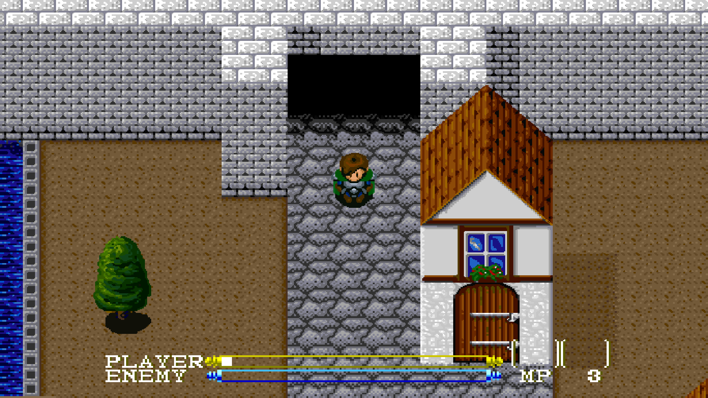
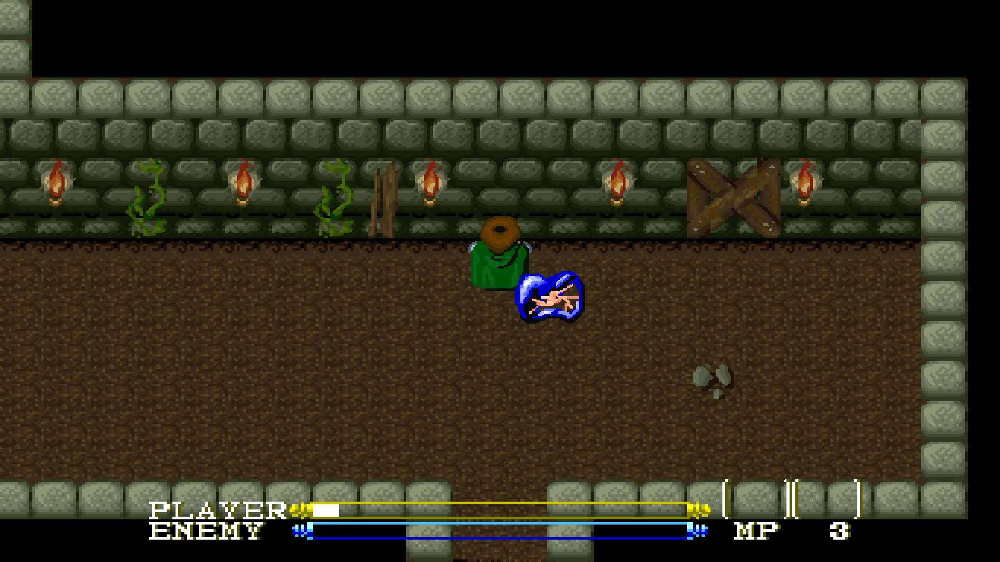
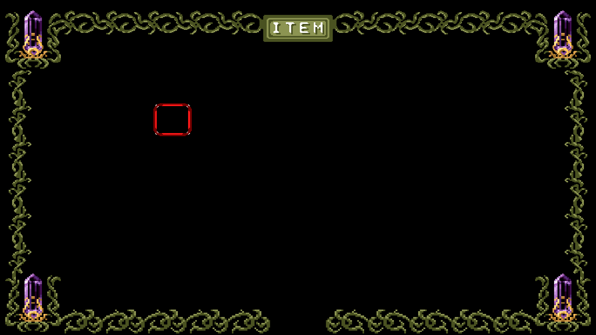
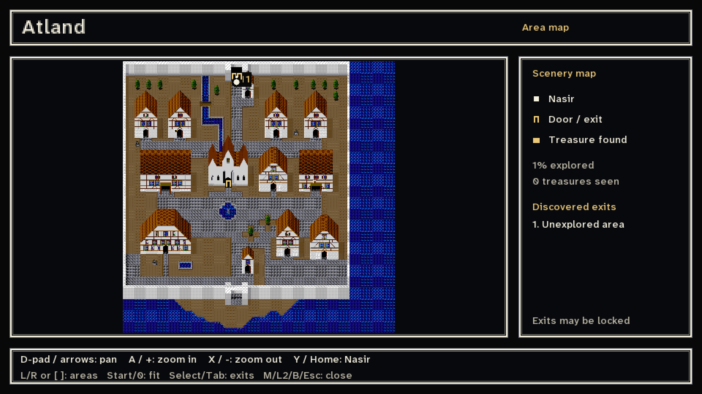
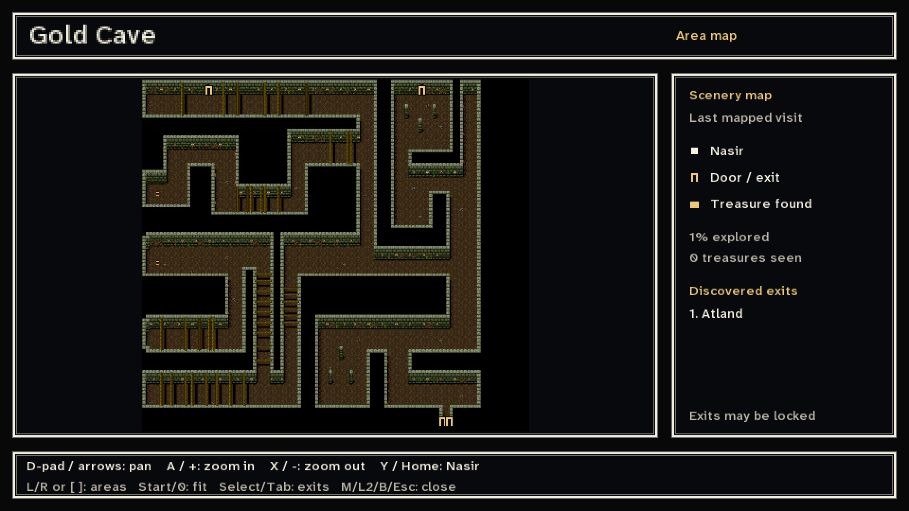
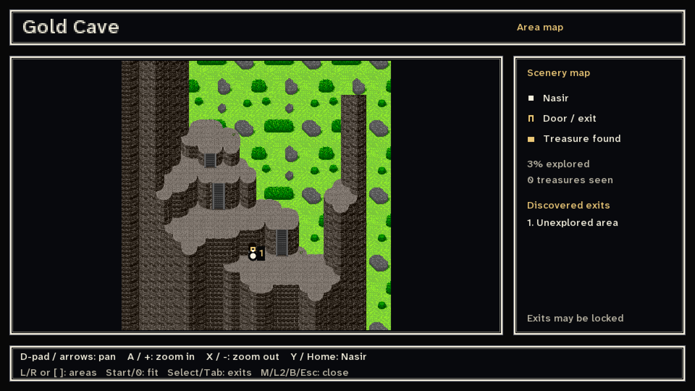
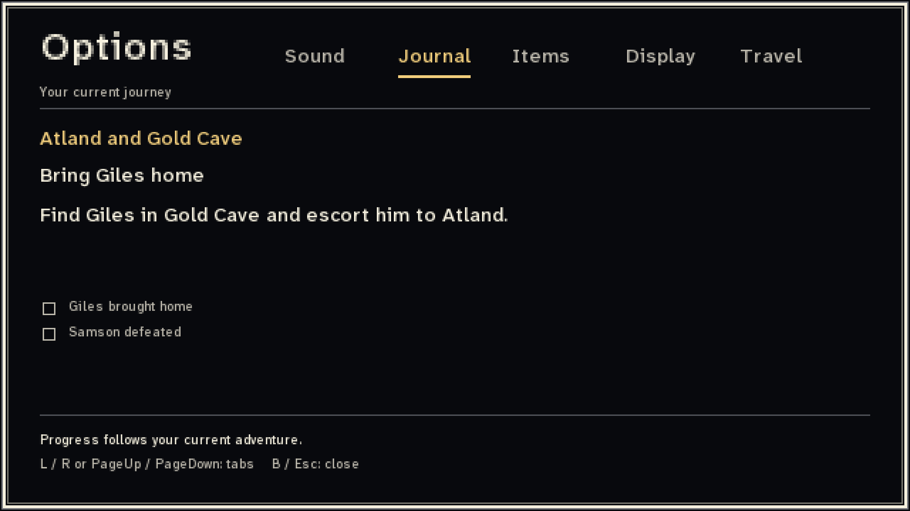
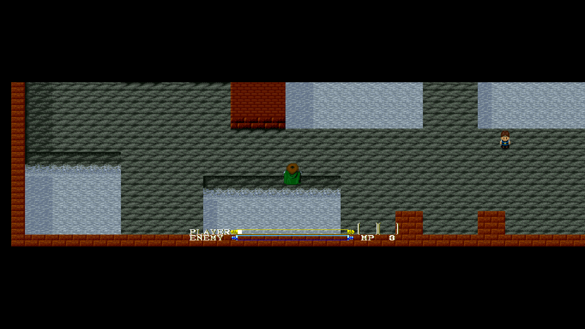
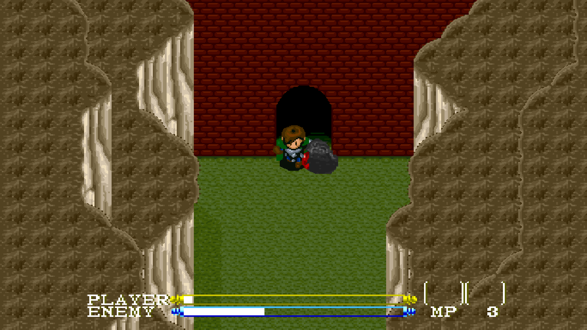
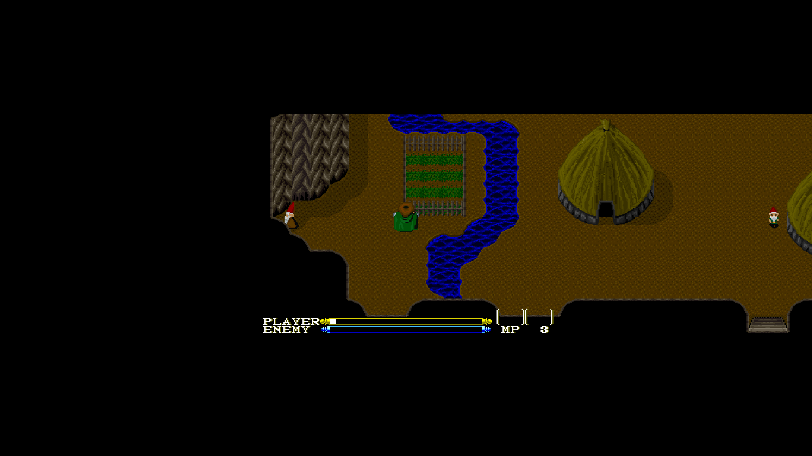

# Screenshots

Actual game output at **1920×1080**, using original artwork. Click an image for
full resolution. Wide fields retain letterboxing on a 16:9 monitor; black beyond
finite map edges is intentional. These captures are development examples,
not a full-game rendering or performance guarantee.

## Atland — Enhanced pixels, 16:9

Actual OpenGL fullscreen readback with EPX and camera centering.

## Atland streets — Enhanced pixels, 32:9

Actual **1920×1080 hidden OpenGL EPX readback**, captured during ordinary
held-direction walking after assisted positioning. The view is letterboxed at
32:9. This replaces an older image that showed an isolated door. The legacy
filename includes “fullscreen”; this new capture uses a hidden nonfullscreen
window and does not verify physical fullscreen scanout. A short back-and-forth
route did not reproduce the reported movement flicker; broader playtesting
remains necessary. [Capture metadata](captures.json).

## Atland dialogue — 21:9, 1920×1080

Actual SDL fullscreen output during an ordinary NPC conversation. Text is still
typing; the world remains wide around the centered dialogue. The unused all-zero
readback alpha was removed so browsers display the image; RGB pixels and resolution
are unchanged. This is an earlier development capture, not a current FPS benchmark.
[Full-resolution image](atland-dialogue-21x9-1920x1080.png) · [Capture metadata](captures.json).

## Gold Cave — Enhanced pixels, 16:9

Actual OpenGL desktop-fullscreen readback from an assisted encounter.
The upper black region lies outside the authored cave corridor.
[Metadata](batch19-capture.json).

## Items — Enhanced pixels, 16:9

Actual fullscreen OpenGL output. Text/icons retain original artwork while the
frame expands. The early inventory is mostly empty. [Metadata](captures.json).

## Scenery maps and journal — 0.4.0

Actual **1920×1080 hidden OpenGL readbacks** of the new map. Full scenery uses
the current area's own tiles and palette, with fixed-size labels and markers.
**M / L2** opens it; arrows pan, A/X or +/- zoom, L/R browse retained visited scenery,
Y recenters and Start fits the area. The Atland image is browsed while in Gold
Cave; the Gold Cave image is browsed from another area after a process restart.
"Last mapped visit" identifies retained terrain. Older exploration-only areas
gain scenery on a fresh visit; unavailable scenery retains the labeled layout.
Only discovered exits receive
numbered destination entries; seeing terrain does not grant exploration or items.

The **R2 / Ctrl+comma** Options menu uses the same readable frame and font.
The journal follows actual story flags; it does not write quest progress.

These bounded development routes use retained states; the layered area uses an
assisted original door-loader destination. They do not represent a new campaign
or physical fullscreen test. [Capture metadata](map-captures.json).

## Later areas — Enhanced pixels

Room19 at 32:9, with the original NPC patrol to Nasir's right.
[Metadata](batch26-captures.json).

Room18 at 16:9. [Metadata](batch27-capture.json).

Room24 at 32:9. [Metadata](batch28-capture.json).

These three are lossless 1920×1080 OpenGL readbacks from hidden, nonfullscreen
windows with dummy audio, using assisted original room loaders. They are distinct
from the visible fullscreen captures above and do not certify physical scanout.

[Playing/settings](../PLAYING.md) · [Renderer scope](../DEVELOPMENT.md#renderer)
