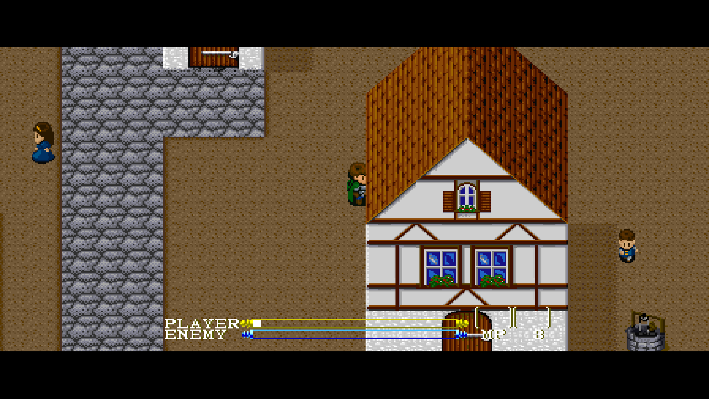
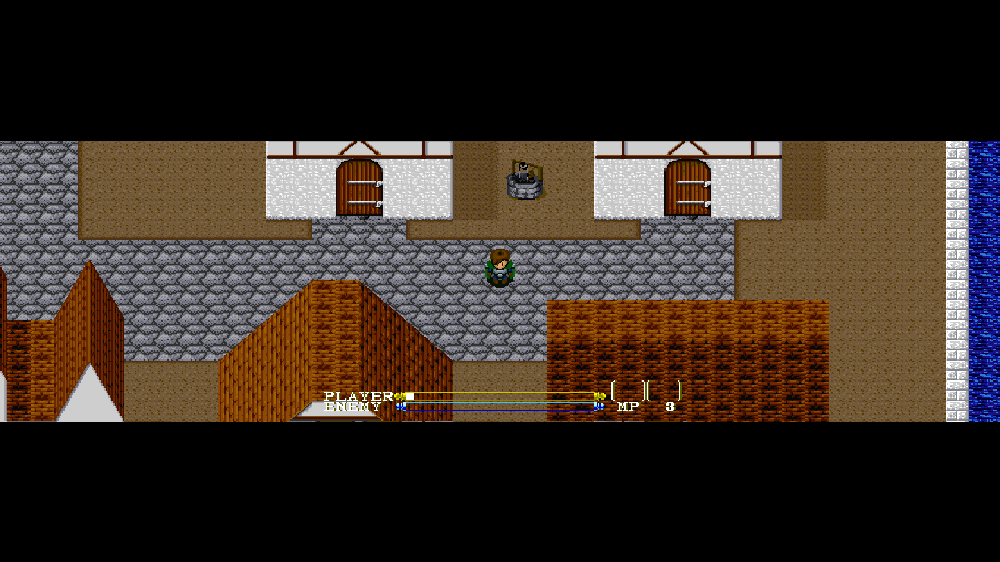
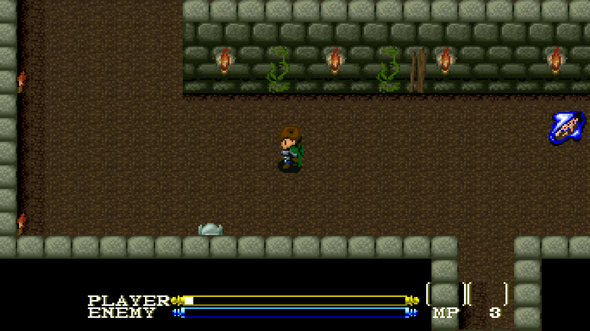

# Fullscreen widescreen captures

The first three PNGs were captured from the actual Windows SDL fullscreen output at
**1920×1080**, with nearest-neighbor filtering and camera centering enabled.
They retain the monitor's letterboxing for 21:9 and 32:9 fields. Click an image
to view or download its full resolution.

## Atland — 21:9

## Atland — 32:9

## Gold Cave — 16:9

This is experimental additional scenery and actor rendering at the original
game scale. The HUD stays centered. Current audited dialogue and Start/status
screens keep their surrounding world scenery; the known Items/Magic frames
expand using their original artwork. Titles, unsupported intro layouts, other
menus and unknown room resources retain centered native fallback. The cave capture uses
the documented position-only guard bypass to reach its real entrance.

Capture frame numbers, feature selection and source executable identity are in
[capture metadata](captures.json). The PNGs preserve the fullscreen readback
pixels; raw 224-line diagnostic captures are kept privately.

## Atland - enhanced original pixels, 16:9

Actual 1920 by 1080 OpenGL fullscreen readback with optional EPX and immediate
camera following. Original colors and sharp HUD; no redrawn artwork or artificial
screenshot upscale. The same-build stock/EPX pair preserves guest snapshots,
clock and all 1,762 pre-shader presentation entries. The full retexture idea is
shelved. See [enhanced pixels](../ENHANCED-PIXELS.md).

## Atland dialogue — 21:9, 1920×1080

Actual Windows SDL fullscreen output from the batch 6 build, with nearest
filtering and camera centering. Ordinary walking leads into the real NPC
conversation; the text is still typing. The dialogue remains centered while
both sides retain the surrounding town. The PNG preserves the full-resolution
RGBA readback without any post-capture resizing. This visible run measured
46.2 host frames per second with normal frame delay; it is not a steady-60-FPS
performance claim.

## Items — 16:9, Enhanced original pixels

## Magic — 32:9, Enhanced original pixels

These are actual 1920×1080 fullscreen OpenGL readbacks from batch 6. Original
text/icons stay centered while the original frame expands. The early inventory
is mostly empty; populated late-game panels need further checks. The 32:9 field
is letterboxed on this 16:9 monitor. See [menu qualification](../MENU-PRESENTATION.md).
