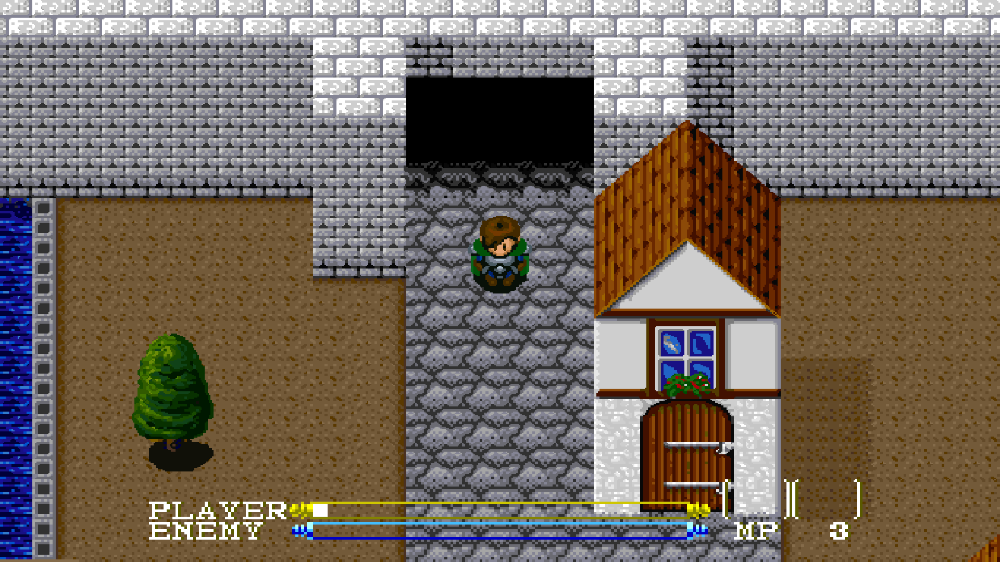
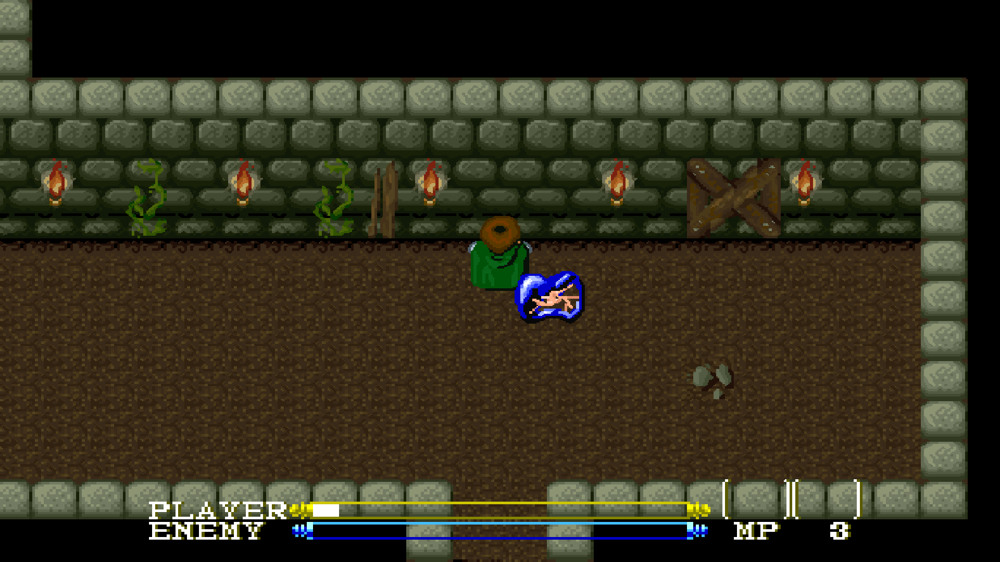
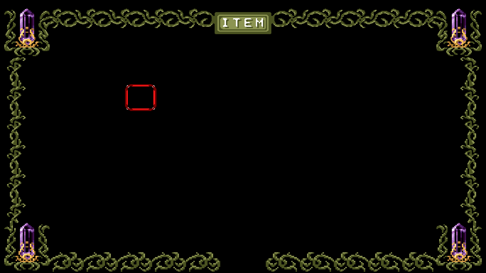
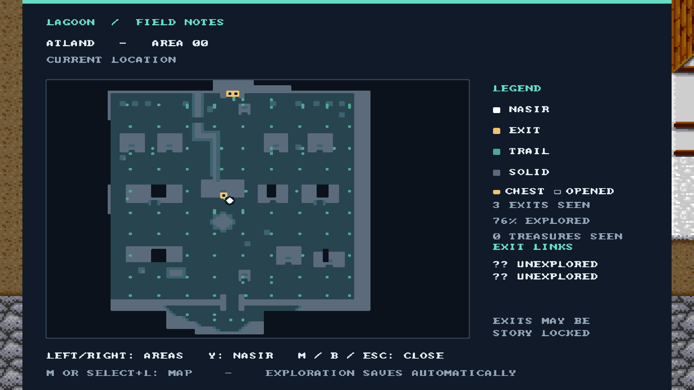
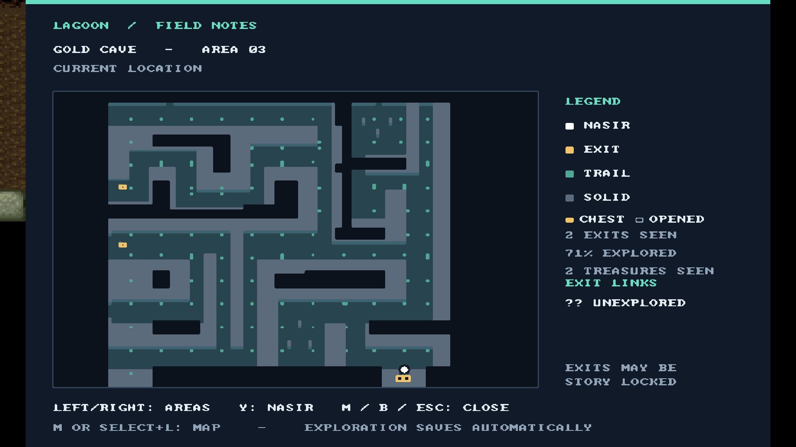
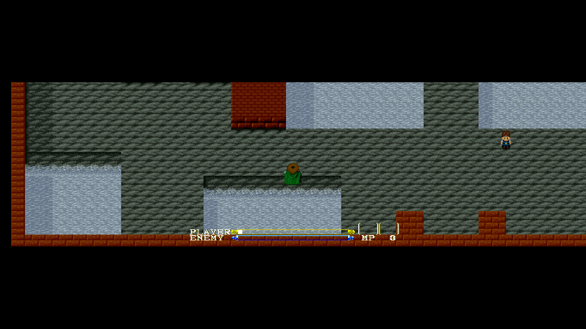
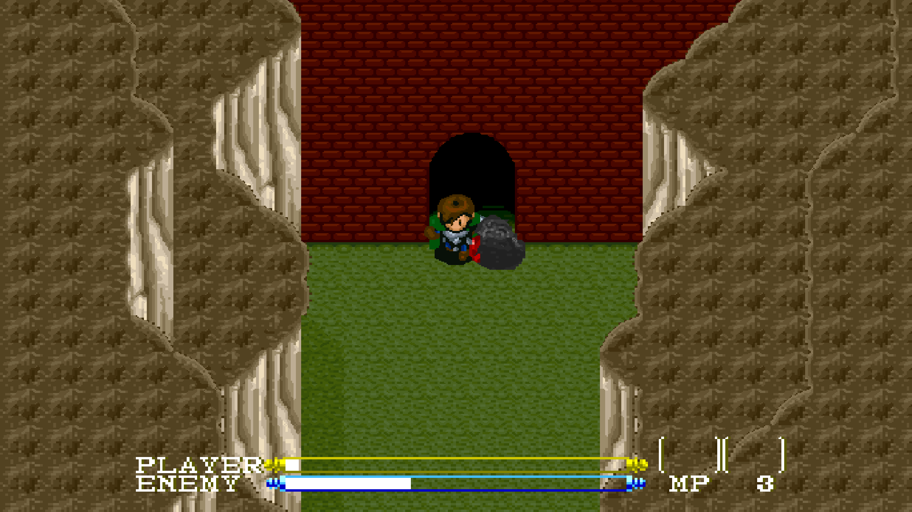
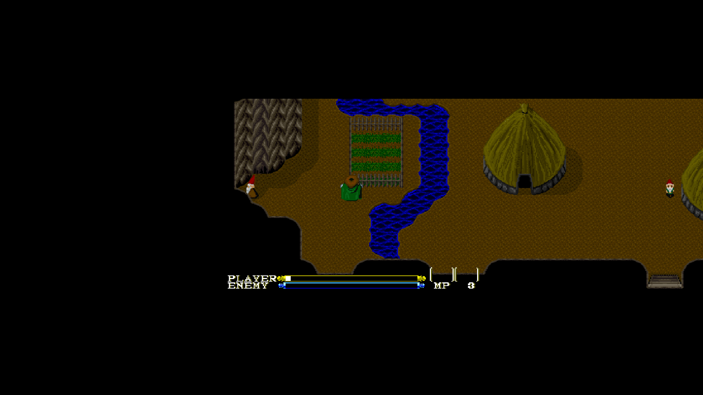

# Screenshots

Actual game output at **1920×1080**, using original artwork. Click an image for
full resolution. Wide fields retain letterboxing on a 16:9 monitor; black beyond
finite map edges is intentional. These captures are development examples,
not a full-game rendering or performance guarantee.

## Atland — Enhanced pixels, 16:9

Actual OpenGL fullscreen readback with EPX and camera centering.

## Atland dialogue — 21:9, 1920×1080

Actual SDL fullscreen output during an ordinary NPC conversation. Text is still
typing; the world remains wide around the centered dialogue. The unused all-zero
readback alpha was removed so browsers display the image; RGB pixels and resolution
are unchanged. This is an earlier development capture, not a current FPS benchmark.
[Full-resolution image](atland-dialogue-21x9-1920x1080.png) · [Capture metadata](captures.json).

## Gold Cave — Enhanced pixels, 16:9

Actual OpenGL desktop-fullscreen readback from an assisted encounter.
The upper black region lies outside the authored cave corridor.
[Metadata](batch19-capture.json).

## Items — Enhanced pixels, 16:9

Actual fullscreen OpenGL output. Text/icons retain original artwork while the
frame expands. The early inventory is mostly empty. [Metadata](captures.json).

## Explored map — Atland and Gold Cave

Actual **1920×1080 desktop-fullscreen OpenGL captures**. The map shows Nasir,
observed terrain, visited positions, discovered exits and treasure markers.
Unvisited destinations stay unknown. Open with **M** or **Select+L**; browse
visited areas with Left/Right and return to Nasir with Y. Gameplay pauses while
browsing, and exploration saves automatically.

These private development routes used assisted movement to reveal nearby
geometry through the running game. They do not represent a natural playthrough.
[Capture metadata](map-captures.json).

## Later areas — Enhanced pixels

Room19 at 32:9, with the original NPC patrol to Nasir's right.
[Metadata](batch26-captures.json).

Room18 at 16:9. [Metadata](batch27-capture.json).

Room24 at 32:9. [Metadata](batch28-capture.json).

These three are lossless 1920×1080 OpenGL readbacks from hidden, nonfullscreen
windows with dummy audio, using assisted original room loaders. They are distinct
from the visible fullscreen captures above and do not certify physical scanout.

[Playing/settings](../PLAYING.md) · [Renderer scope](../DEVELOPMENT.md#renderer)
