# Screenshots

Actual game output from both editions, using the original artwork. Click an
image for its full-size export. The captions identify the edition, zoom and
capture method; these examples are not a full-game performance guarantee.

## X68000 Enhanced

### Atland - 1.25x world zoom

[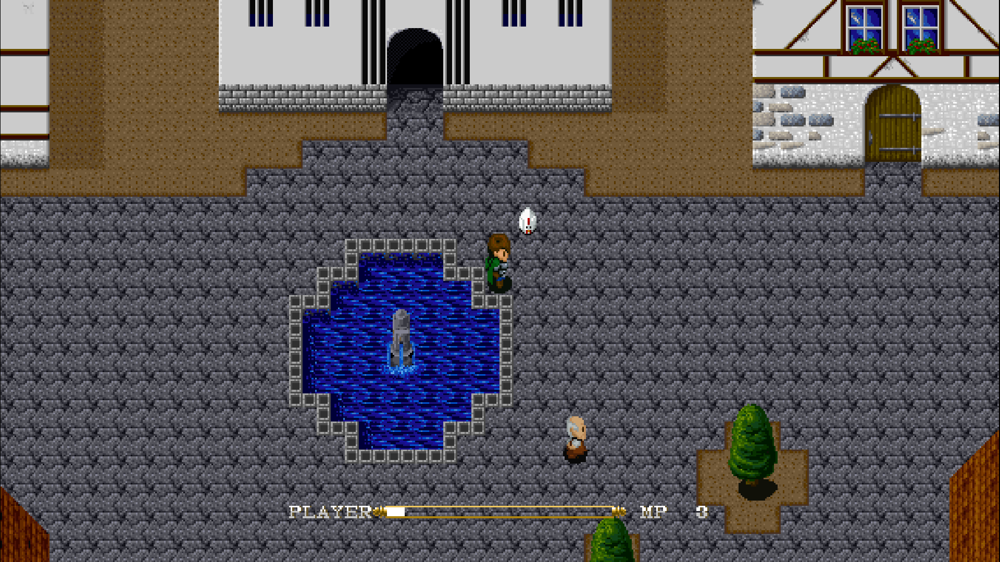](x68000-atland-zoom125-1920x1080.png)

The new-install 1.25x view shows the fountain, surrounding buildings and NPCs,
with the original HUD at the bottom. Source compositor canvas: **568x320**.

### Voloh - 1.5x world zoom

[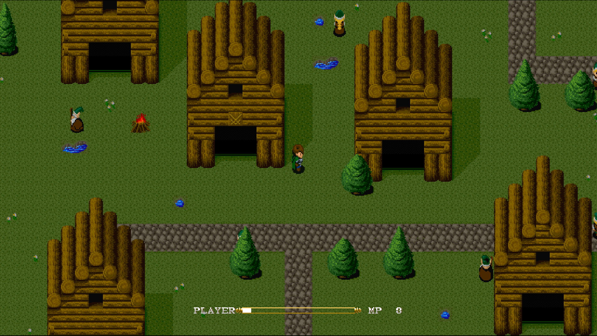](x68000-voloh-zoom150-1920x1080.png)

The wider view includes more of the elven village while retaining the original
artwork and centered camera. Source compositor canvas: **684x384**.

### Gold Cave cliff near Giles - 1.5x world zoom

[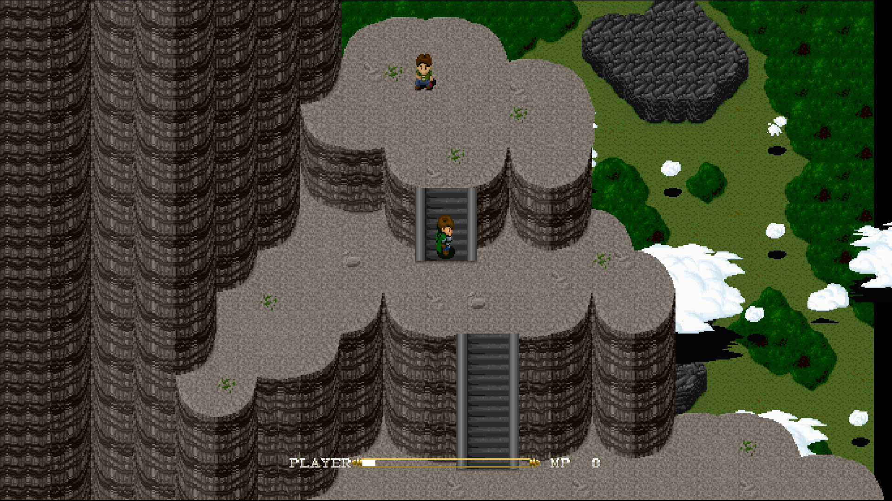](x68000-giles-cliff-zoom150-1920x1080.png)

Nasir is on the original stairs below Giles. The expanded view retains the
cliff, clouds and original dark cloud-shadow artwork. Source compositor canvas: **684x384**.

### Castle approach - 1.5x world zoom

[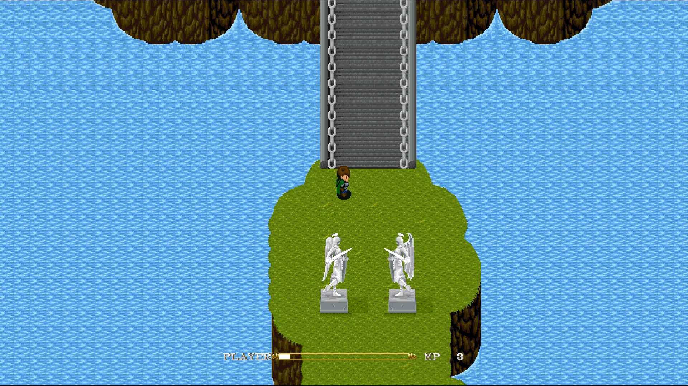](x68000-castle-zoom150-1920x1080.png)

The castle approach provides a view of the bridge, statues and water beyond
the original viewport. Source compositor canvas: **684x384**.

These are **actual expanded-compositor captures**, nearest-neighbor scaled and
aspect-fitted to **1920x1080**. They are not OS fullscreen captures or native HD
replacement artwork. They show normal game rendering.
[X68000 controls](../PLAYING.md#x68000-enhanced).
[Capture metadata](x68000-captures.json).

## SNES Enhanced

The SNES images below are actual **1920x1080** runtime readbacks. Wide fields
retain letterboxing on a 16:9 monitor; black beyond finite map edges is
intentional. Each older capture retains its original version and scope below.

### Gold Cave above Giles — 0.5.3

[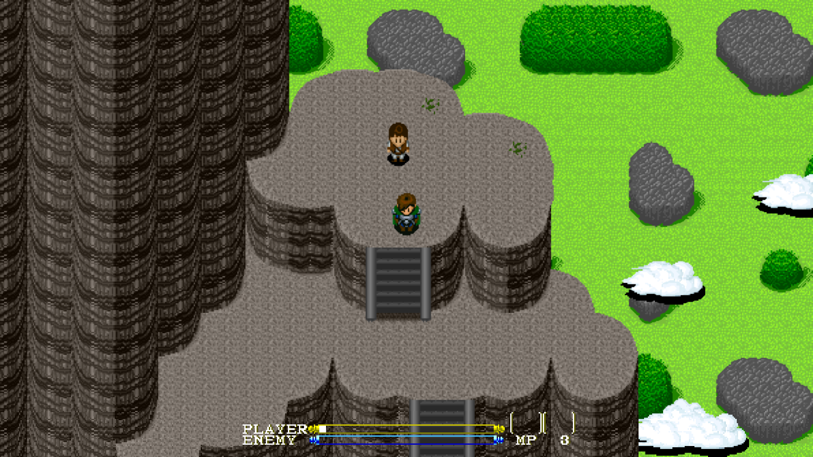](gold-cave-giles-clouds-square-zoom150-1920x1080.png)

Actual **1920×1080 D3D11 GPU readback**, with square pixels, 16:9, 1.5x world
zoom and runtime-confirmed MMPX. The original Gold Cave cloud groups extend
beyond the old viewport and retain their foreground-cliff priority. This uses
an assisted original Giles rescue state, a cosmetic wind-counter preset and
ordinary controls. It is a hidden-window readback, not physical fullscreen
scanout or a new campaign. [Capture metadata](renderer77-captures.json).

### Square pixels and live1.5x zoom — 0.5.2

[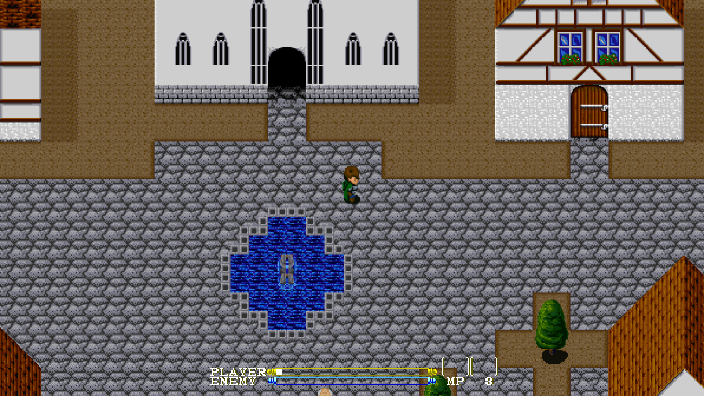](atland-square-zoom150-1920x1080.png)

[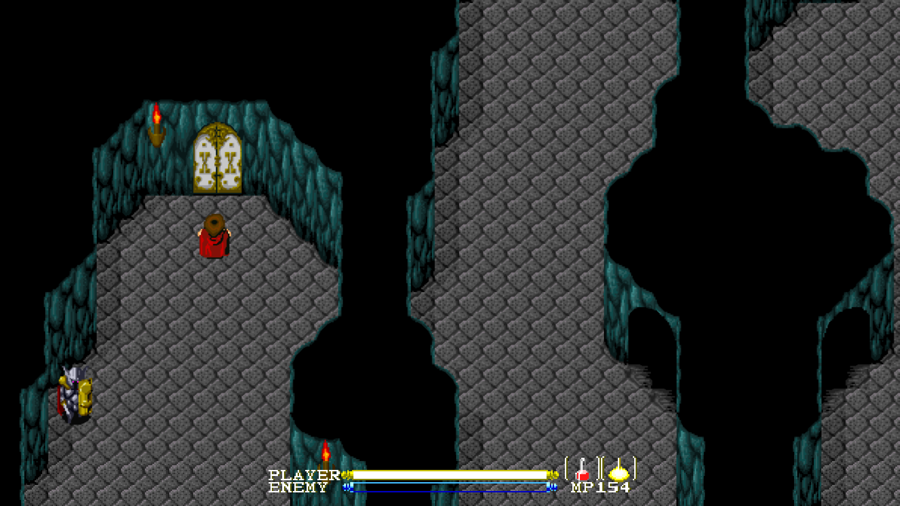](castle-square-zoom150-1920x1080.png)

Actual1920×1080 D3D11 GPU readbacks: **Square pixels + widescreen +1.5x world
zoom out**, with MMPX. Captured after movement from checkpoints; Atland uses
an assisted original door-loader entry. These hidden-window captures do not
certify physical fullscreen scanout. [Capture metadata](renderer76-captures.json).

The Phantom Hill image was replaced after the follow-up cloud fix. It shows
the complete decorative cloud continuing beyond its original sprite lifetime,
with a bird in the expanded view. The capture uses the exact `46ae4f716…` build;
later actor fixes have separate checks. Other images retain their individual
capture-build hashes in the metadata rather than being presented as new captures.

[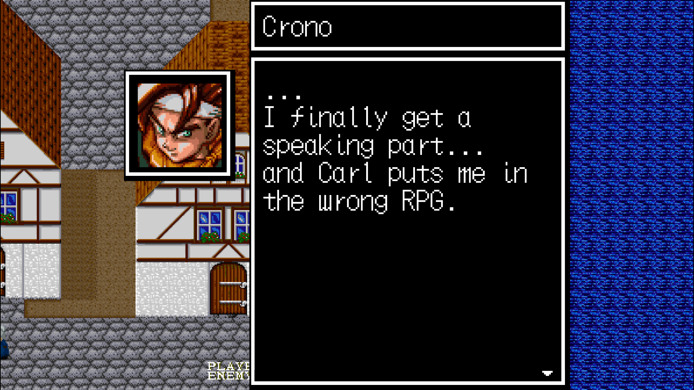](cameo-dialogue-square-1920x1080.png)

Change zoom live through **Options → Display**, **R3**, or **Ctrl+Z**.
[Display and recording help](../RECORDING.md).

### Atland — Enhanced pixels, 16:9

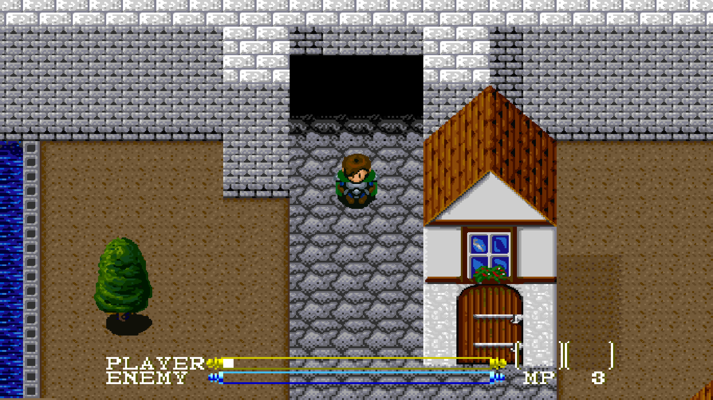

Actual OpenGL fullscreen readback with EPX and camera centering.

### Atland streets — Enhanced pixels, 32:9

Actual **1920×1080 hidden OpenGL EPX readback**, captured during ordinary
held-direction walking after assisted positioning. The view is letterboxed at
32:9. This replaces an older image that showed an isolated door. The legacy
filename includes “fullscreen”; this new capture uses a hidden nonfullscreen
window and does not verify physical fullscreen scanout. A short back-and-forth
route did not reproduce the reported movement flicker; broader playtesting
remains necessary. [Capture metadata](captures.json).

### Atland dialogue — 21:9, 1920×1080

Actual SDL fullscreen output during an ordinary NPC conversation. Text is still
typing; the world remains wide around the centered dialogue. The unused all-zero
readback alpha was removed so browsers display the image; RGB pixels and resolution
are unchanged. This is an earlier development capture, not a current FPS benchmark.
[Full-resolution image](atland-dialogue-21x9-1920x1080.png) · [Capture metadata](captures.json).

### Gold Cave — Enhanced pixels, 16:9

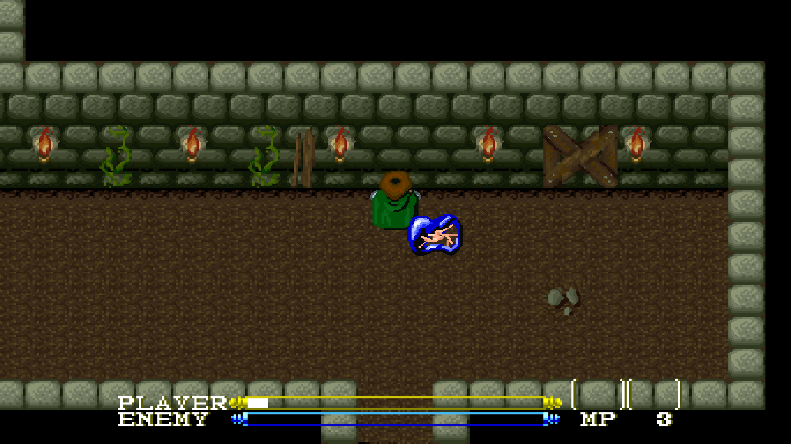

Actual OpenGL desktop-fullscreen readback from an assisted encounter.
The upper black region lies outside the authored cave corridor.
[Metadata](batch19-capture.json).

### Items — Enhanced pixels, 16:9

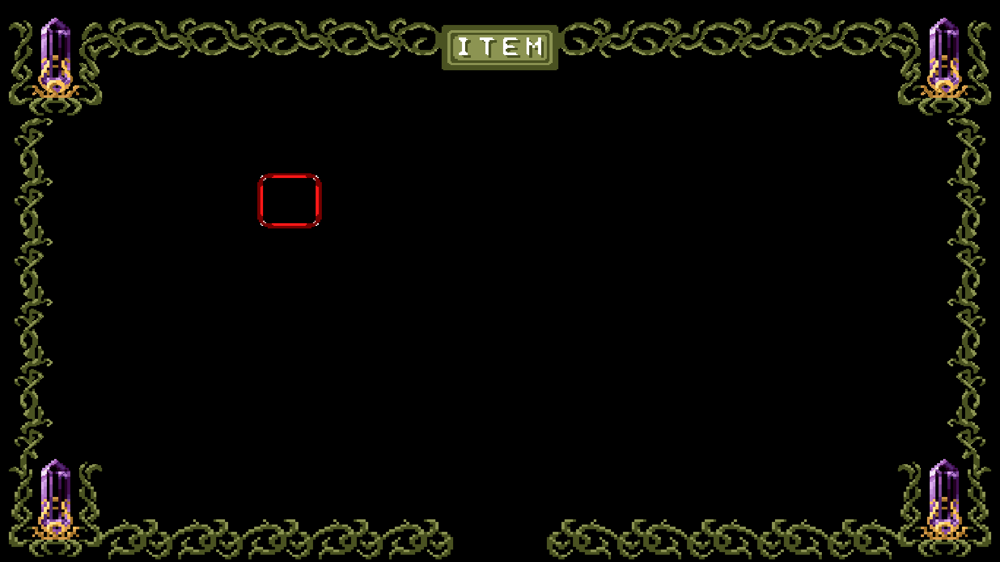

Actual fullscreen OpenGL output. Text/icons retain original artwork while the
frame expands. The early inventory is mostly empty. [Metadata](captures.json).

### Scenery maps and journal — 0.4.0

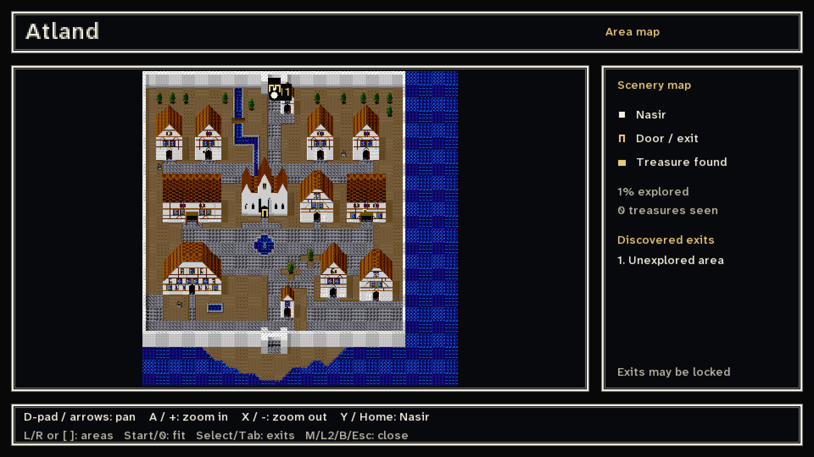

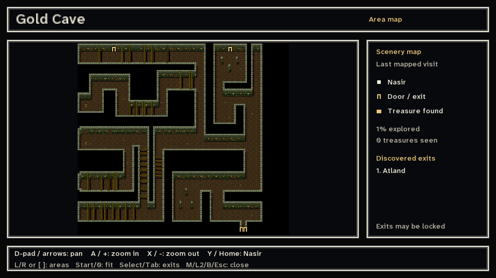

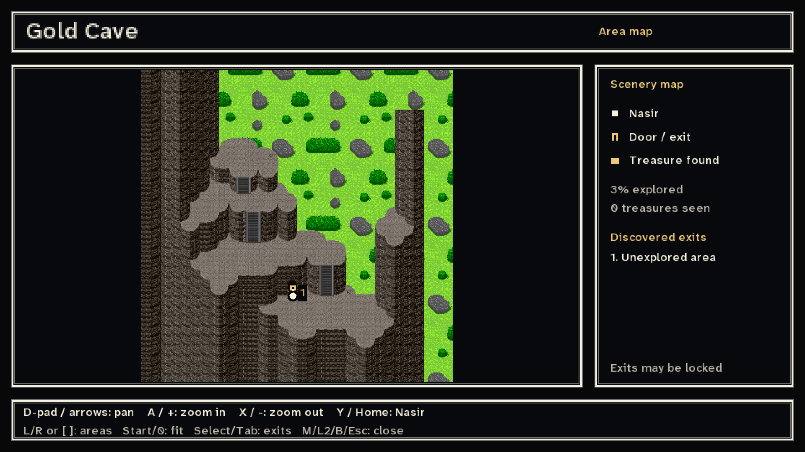

Actual **1920×1080 hidden OpenGL readbacks** of the new map. Full scenery uses
the current area's own tiles and palette, with fixed-size labels and markers.
**M / L2** opens it; arrows pan, A/X or +/- zoom, L/R browse retained visited scenery,
Y recenters and Start fits the area. The Atland image is browsed while in Gold
Cave; the Gold Cave image is browsed from another area after a process restart.
"Last mapped visit" identifies retained terrain. Older exploration-only areas
gain scenery on a fresh visit; unavailable scenery retains the labeled layout.
Only discovered exits receive
numbered destination entries; seeing terrain does not grant exploration or items.

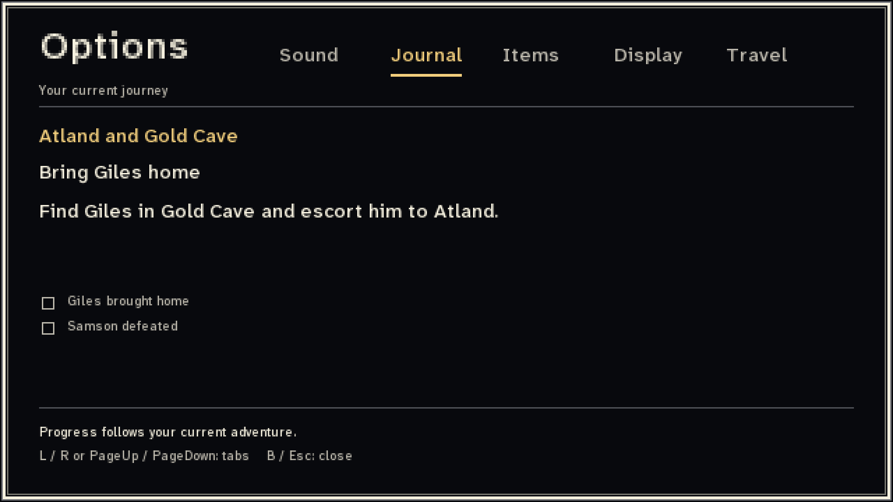

The **R2 / Ctrl+comma** Options menu uses the same readable frame and font.
The journal follows actual story flags; it does not write quest progress.

These bounded development routes use retained states; the layered area uses an
assisted original door-loader destination. They do not represent a new campaign
or physical fullscreen test. [Capture metadata](map-captures.json).

### Later areas — Enhanced pixels

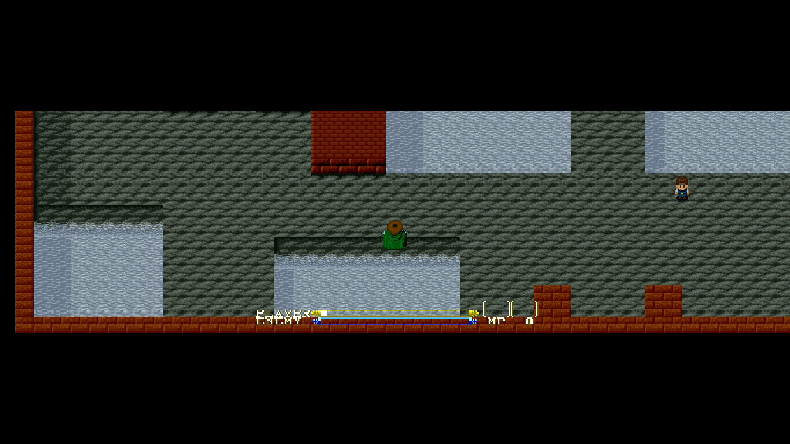

Room19 at 32:9, with the original NPC patrol to Nasir's right.
[Metadata](batch26-captures.json).

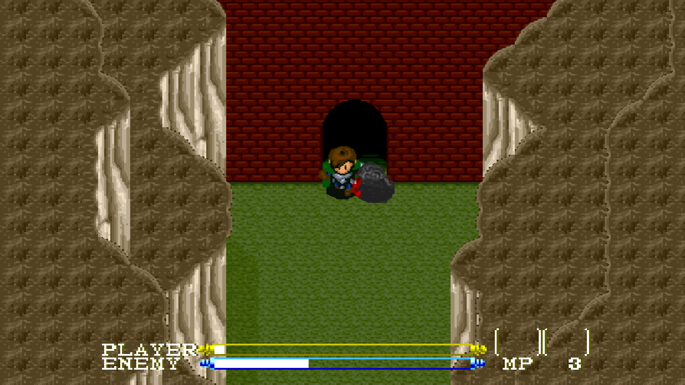

Room18 at 16:9. [Metadata](batch27-capture.json).

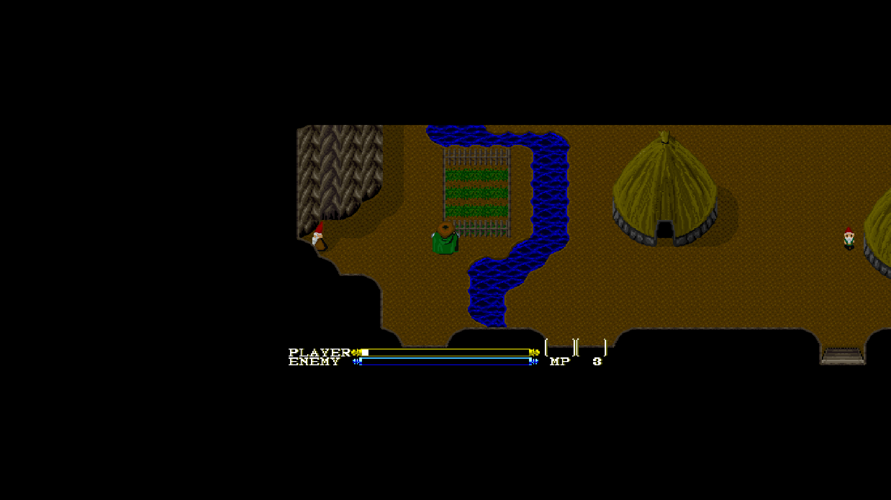

Room24 at 32:9. [Metadata](batch28-capture.json).

These three are lossless 1920×1080 OpenGL readbacks from hidden, nonfullscreen
windows with dummy audio, using assisted original room loaders. They are distinct
from the visible fullscreen captures above and do not certify physical scanout.

[Playing/settings](../PLAYING.md) · [Renderer scope](../DEVELOPMENT.md#rendering-and-pacing)
